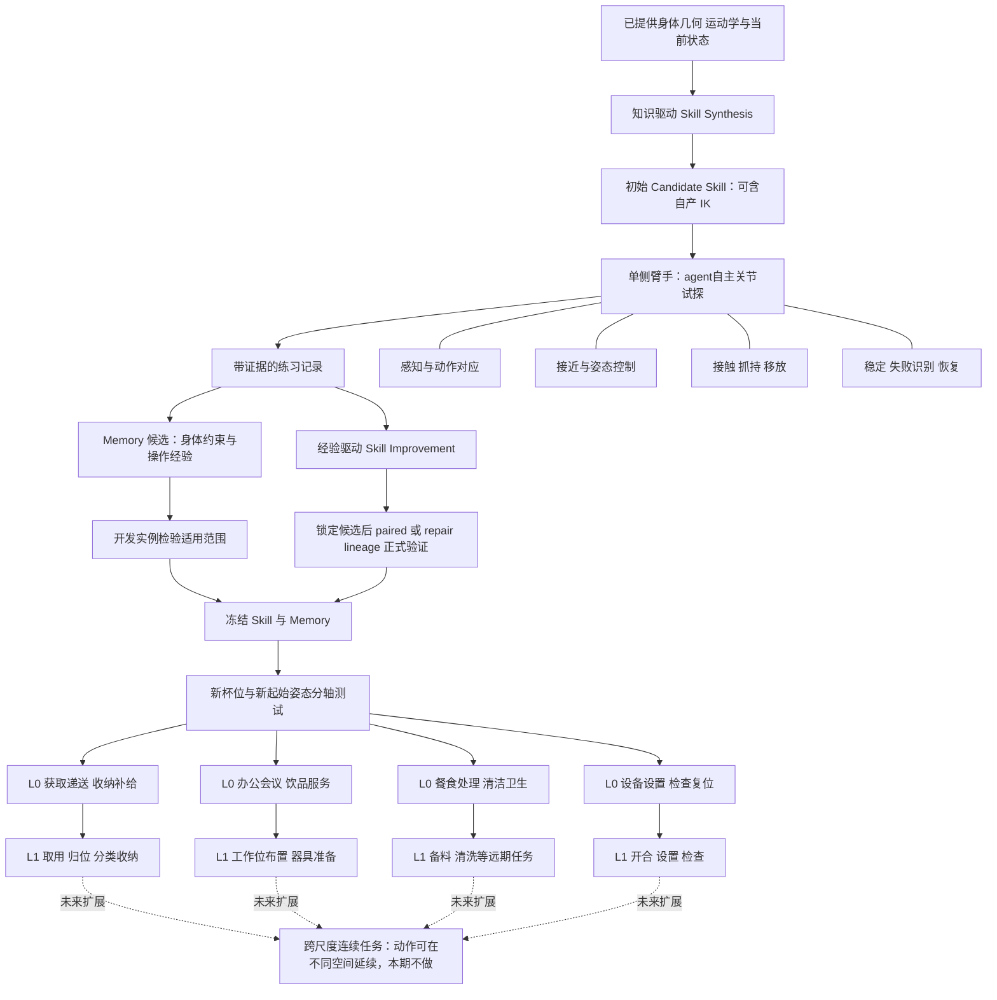

# 身体熟悉到应用任务的能力成长树

日期：2026-10-24；2026-10-25 更新候选晋升规则并加入修复谱系验证。Q1–Q12 已对齐。知识合成与经验改进分别归因，自主 IK 合法，正式验证可采用同初态 Skill 配对或完整修复谱系，可选同杯分轴扩展，OCL 后续独立。完整实施顺序和数值协议见 [Grow Up 最小实验方案](GROW_UP_MINIMAL_EXPERIMENT.md)；首批工程工具闭环已运行，自主关节学习主实验仍未完成。

## 1. 已确认与未确认

- 身体操作是主干：练习中形成 memory / skill，支撑 L0 / L1 应用任务；跨尺度连续任务只保留为未来方向。
- 主要目标：系统积累经验后，在新任务实例上表现更好。
- 允许读取传感器等数据；主实验直接给关节下指令，通过试探熟悉运动关系，不使用现成 IK 代替这一过程。
- Skill 已确定为可执行程序，memory 已确定为条件与经验知识；程序须遵守同样的动作接口边界。
- Agent 自主编写、调试和改进的 IK / 运动学程序合法；只使用初始资料、白名单 API、自身反馈，最终仍发关节指令。知识合成和经验改进分开报告。
- Candidate 可通过两条路径成为范围受限的正式 Skill：同一保存初态的“使用 / 不使用 Skill”实际执行配对显示改善，或完整保留失败、合法诊断和有界修复后，在同一实际初态完成脚本与 agent 双复验；跨 seed 与新杯位 / 初始姿态分轴改为可选扩展验证，OCL 另立后续实验。
- 根据 Q7 图片，提供关节、坐标与单位、限值、连杆几何与运动学资料、当前 FK、初始状态及动作后掌位；研究不是从零发现身体结构。
- 先单侧臂手；agent 自己选择试探、提炼 memory、生成 skill 程序。沿用左侧 14 关节作为实现建议，不是用户指定。
- 图片中现成 `move_ee()` 只是既有接口描述，不覆盖关节级动作边界；Agent 自主实现不同于调用该现成工具。任务物体真值、工程教师轨迹不提供；整体协议数值待确认。
- 上一版目的目录保留为应用层。选择“迁移收益”不意味着用户同意用完整工程技能跳过身体熟悉。

## 2. 总体树图

这是能力发展与依赖结构，不是把身体练习、知识和生活任务当成同一种分类。虚线表示共享支持或未来扩展；一个任务往往依赖多个技能，底层关系是图，展示时可以按树展开。



图中的清洗、烹调等只是远期覆盖，不代表现有仿真支持流体、温度或清洁状态。各 L0 / L1 完整列表保留在[应用目录](T0_TASK_TAXONOMY.md)。

## 3. 身体主干的练习分支

使用 B 编号与 L0 / L1 应用目录区分。这是本项目设计，不是某个 benchmark 的官方身体分类，也不是必须从零学完的课程。

| 身体分支 | 练习子项 | Memory 候选 | Skill 候选 / 验证目标 |
|---|---|---|---|
| B1 感知与动作对应 | B1.1 关节与反馈；B1.2 小动作与末端变化；B1.3 局部可达性；B1.4 观测延迟与重观测 | 实际动作影响、受限区域、观测有效条件 | 有界试探、局部到达；身体几何已提供，区分资料推导与交互所得 |
| B2 无接触运动与姿态 | B2.1 伸手接近；B2.2 手掌朝向；B2.3 中间位姿；B2.4 安全回撤 | 姿态、路径的适用条件 | 通过关节级试探形成接近、定向与回撤程序，不调用现成 IK |
| B3 接触与抓持 | B3.1 探测接触；B3.2 分指合拢；B3.3 对向抓持；B3.4 小试提与稳持 | 接触与滑脱信号、合指顺序的适用范围 | 闭环抓持；触觉推断与对象身份真值验收分开 |
| B4 带物移动与释放 | B4.1 保姿移物；B4.2 接近支撑；B4.3 卸载与释放；B4.4 撤手后检查 | 释放条件、落稳信号 | 移送与放置，不是重播固定关节序列 |
| B5 稳定、异常与恢复 | B5.1 不可达；B5.2 未抓稳；B5.3 停止重观测；B5.4 有界恢复与退出 | 失败征兆、恢复条件、停止规则 | 安全退出、重定位与有限重试；保护器行为不算模型新学能力 |
| B6 多肢体与身体移动 | B6.1 双手交接；B6.2 双手协同；B6.3 躯干配合；B6.4 房内移动接近 | 多肢体和位置姿态耦合约束 | 后期协同 / 移动候选，当前无对应学习证据 |

首批建议从 B1 / B2 的小幅关节试探、动作效果与安全到达开始，再逐步进入 B3 / B4 接触操作，不要求一步覆盖整条抓杯链。每形成候选单元，就在开发实例验证；不要求全身体练习完成后才做任务。修正只用练习 / 开发集，留出测试不用于反复修改经验。

## 4. 同一经历可以产生 memory 和 skill

Memory 为条件和经验知识、skill 为可执行程序，已由用户确认。下表的证据与晋升检查是建议协议，具体阈值尚未确定。

| 产物 | 内容 | 后续使用 | 不能等同于 |
|---|---|---|---|
| 原始记录 | 动作、观测、反馈、结果事实 | 回放、提取证据 | 已抽象经验或技能 |
| Memory 候选 | 带适用条件的身体知识、参数规律、失败经验 | 检索后指导决策与参数选择 | 可直接执行的控制器 |
| Skill 候选 | 输入观测与参数、通过关节指令尝试达成子目标的可执行程序 | 前置条件成立时调用，过程中检查反馈 | 一次成功视频或固定轨迹 |
| 已验证可复用 skill | 在明确范围内通过独立实例验证的行为单元 | 在适用范围内调用、组合 | 任意对象、任意位置都可靠 |

例如练习中观察到：指定杯型和接近姿态下，合指时掌位偏移与抓持失败相伴。

- Memory 候选可以是“闭合时监测掌位，超过已验证范围先停下并重观测”，附成功 / 失败证据；不能直接把相关性写成普遍因果规律。
- Skill 候选可以是参数化的“接近 -> 闭环合指 -> 检查接触 -> 小试提 -> 成功或退出”。必须记录程序由哪些练习证据产生；不能复制工程抓取或暗调现成 IK 后称为自主积累所得。
- “直接调用”是复用参数化、会看反馈的程序，不是忽略新状态机械重播。自然语言流程可以作 memory，但本项目不再将其单独称为可执行 skill。

不要求每条 memory 都变为 skill，也不要求每个 skill 都先经过自然语言摘要。

## 5. 应用树与未来跨尺度设想

```text
身体操作练习与证据
  -> 候选 memory / skill 的提炼与验证
    -> 共享能力支撑应用任务
       L0-01 物品获取与递送
         L1-01.01 指定物品取用 / L1-01.04 指定地点递送
       L0-02 整理、收纳与补给
         L1-02.01 用后归位 / L1-02.02 按类别分拣
       L0-03 办公与会议准备
         L1-03.01 工作位准备 / L1-03.02 多座位会议布置
       L0-04 食材与餐食处理
         L1-04.01 备料 / L1-04.06 加热烹调（远期）
       L0-05 饮品准备与服务
         L1-05.01 器具准备 / L1-05.04 冲泡制饮（远期）
       L0-06 清洁、卫生与废弃物处理
         L1-06.01 废弃物收集 / L1-06.04 器具清洗（远期）
       L0-07 设施、设备与环境设置
         L1-07.01 门柜开合 / L1-07.02 按钮拨杆设置
       L0-08 状态检查与安全复位
         L1-08.01 在位数量检查 / L1-08.04 安全状态恢复

未来跨尺度连续任务示意（不纳入本期）：
  在茶水间取物 -> 持物移动 -> 在另一空间放置 -> 继续后续动作
```

同一“抓取—移放”skill 可以支持多个 L0，不需要复制多份。本期可以包含完成一个房间内任务所必需的连续动作，但不以“多个 L1 分类拼在一起”定义跨尺度，也不把跨尺度任务作为本期验收要求。

按用户澄清，跨尺度更像一系列连续动作，动作可能发生在不同空间；这只是未来设想。上一轮将它优先解释为“短动作到多子任务的抽象层级”的建议不采用。具体连续性、跨空间划分和重置规则到未来启动该方向时再定义。

## 6. 当前接口事实与已选动作边界

只读核对当前代码后，已有三层能力不能混称为 tool：

| 层 | 当前实现 | 边界 |
|---|---|---|
| 身体观测 | `state()` 与 `fk(side)` | 关节、力矩、掌位、IMU、触觉等；FK 只报告当前掌位，不是任意假设关节角的查询 |
| 通用控制辅助 | `set_joints()` 与 `move_ee()` | 前者可作为关节接口候选；后者内部使用 IK，排除在本主实验及其生成技能接口之外 |
| 任务专用工程技能 | `locate/prepare/preflight/approach/close_and_test/lift_and_hold` | 已内置杯子先验、路径、抓持参数和阶段逻辑，不能当普通传感器接口 |

当前 Astra 入口主要调度第三层，并不是已经向模型开放第一、二层直接练习。底层类能读取全部关节和 IMU，也不等于历史 Astra 消息实际包含这些完整数据。

参考：[机器人接口](../../grasp_optimization/pantry_robot.py)、[受限控制边界](../../grasp_optimization/vision_grasp.py)、[Astra 入口](../../grasp_optimization/run_vision_astra.py)。

触觉按手部连杆汇总载荷，不报告碰到杯子还是桌子。杯子位姿、身份等仿真真值用于独立验收，不默认作为策略输入。现成末端 IK 不进入本主实验；当前掌位、身体几何与运动学资料已获确认提供，因此不能将直接关节控制描述为没有先验的身体发现。腿部固定站立控制器、PD 与保护是已有工程能力；限幅或拒绝需记录，不能暗中补全任务。

所有 skill 与在线试探使用同一白名单。允许读取身体资料，不等于允许读取含物体真值的仿真世界、调用隐藏现成 IK 或工程教师轨迹。自主编写数值求解程序已获明确允许，包含知识推导、编程、执行后调试改进；知识来源与反馈来源分别记录。练习阶段可改自产 skill，不改权限、评价器或 agent 框架；测试阶段冻结产物。

两张参考图及与本地接口返回字段的差异，见[信息与实验协议](OBSERVATION_AND_EXPERIMENT_PROTOCOL.md)。截图描述的 `actual_palm` 等字段不完全对应当前代码，不以图片代替实现核对。

## 7. 最小研究闭环

1. 固定观测、动作接口、保护和独立验收，各条件保持一致。
2. 从单侧臂手小幅关节试探开始，agent 自主选择动作并保存成功和失败；身体资料共享，腿部保留固定站立控制，另一侧与腰部采用固定目标的实现默认。
3. 保存反馈前知识合成版本；练习中自主提炼 memory、调试改进 skill，在开发集选候选，锁定后采用同初态有/无 Skill 配对，或对完整失败修复链作同初态双复验。
4. 冻结全部产物；需要扩大适用范围时，再在同杯新杯位 P / 新起始姿态 J 上分轴验证知识合成与经验改进。
5. 进一步比较 K / E 技能版本与显式 memory 无 / 有的 2×2 条件；预算、数据、候选选择与成本按整体协议记录。
6. 在当前房间内逐步测新的初态 / 目标，以及后续对象变化与旧能力保持；跨尺度连续任务不纳入本期闭环。

知识合成条件与经验改进条件具有相同完整身体资料、合法接口和匹配的编程预算；实际执行反馈是否用于改进是明确差异。测试统一不开放新代码生成，临时闭环状态每回合重置。工程策略只作参照；旧版“无历史条件测试时还能自由新生成代码”的宽泛建议由整体冻结协议收紧。OCL 保留为后续独立实验。

优先看留出实例成功率，再看同预算下的代价、重复失败与恢复。技能封装减少模型调用时，必须同时记录物理步数 / 时间，不能靠把一百步藏在一次调用里制造效率收益。同杯换位置只支持实例级迁移，不证明跨对象或新组合。

## 8. 参考工作如何挂到主干

- RoboCasa foundational skills 和持续学习评测：基础技能到复合任务，但不替我们证明身体熟悉机制有效。
- DROC / ExpeL：知识提取、成功失败经验与检索对照。
- Voyager：可执行 skill 验证、入库和组合，不直接照搬游戏动作接口。
- LIBERO / LIBERO-Plus：受控留出变化；Dream-RSI 放在后续探索预算层。

一手来源及限制见[参考文档](BENCHMARK_AND_MEMORY_REFERENCES.md)。
