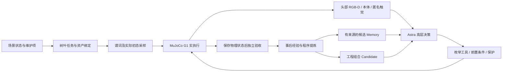

# Grow Up：单侧臂手的自主技能合成、经验改进与冻结迁移

版本：v0.2，2026-10-25。**Q1–Q12 的研究取舍已确认；2026-10-25 用户将候选首次晋升改为两条可选路径：同初态有/无 Skill 配对，或保留完整失败与修复证据的修复谱系验证；跨 seed 改为可选扩展验证。§14 记录已执行的工程开发试验，历史结果不因协议修订而回填。** 本文是当前方案入口；术语见 [GLOSSARY](../../GLOSSARY.md)，研究依据见[参考文档](BENCHMARK_AND_MEMORY_REFERENCES.md)。

## 1. 要回答的问题与不做的事情

主问题：在已知身体资料、允许读取反馈并直接控制关节的条件下，Agent 能否自主构建技能，再利用练习经验改进技能，使其在未见实例上表现更好？

分别报告两条主张：

- **Skill Synthesis**：Agent 利用初始几何知识和允许的程序工具构建可执行控制程序，包括自己写的 FK / IK。能构建不等于已通过执行验证。
- **Skill Improvement**：Agent 根据实际练习反馈修改程序或形成条件经验；迁移收益必须通过与合适对照的留出测试验证。

当前只做单房间、同杯型、单侧臂手，先沿用左臂和左手各 7 关节。腿部由已有稳定器控制，右臂手与腰部目标固定；姿态漂移仍要测，不视为物理固定底座。不同杯型、双臂、行走和跨空间连续任务不是本期必做内容。原计划的 VLA 分支保留为独立可选对照，不混入主实验的自产技能。

Online Continual Learning（OCL）保留为后续独立实验，不混入本轮冻结分数。练习阶段允许 Agent 调试和改进自身 skill；不允许改评价器、放宽安全限制、扩大信息权限或修改 agent 框架来自我豁免。

## 2. 已确认的信息与执行契约

| 边界 | 规定 |
|---|---|
| 初始资料 | Prompt 提供关节、单位、坐标、范围与速度 / 力矩限制、连杆几何和手掌坐标系；发布版本与哈希 |
| 观测 | 合法视觉 / 深度、本体与触觉、当前状态和当前掌位 FK；不把杯子真值、对象身份或分割标签送给策略 |
| 数值推理 | 允许依据初始资料自行编写 FK / IK、优化与控制程序；普通数学运算和线性代数库不等于预置高级求解器 |
| 禁止捷径 | 不读整个仿真内部、隐藏任务真值、评价器实现、工程教师轨迹、预置答案或现成机器人求解 / 抓取代码 |
| 动作出口 | 仅白名单左侧 14 关节绝对角目标及受限等待；不调用现成 `move_ee()` 或工程抓取阶段工具 |
| 代码权限 | Skill 无任意文件、网络、进程或仿真对象访问；只能访问授权资料快照、当前观测和审核后的基础 API |
| 自主性 | Agent 自己写程序、选试探、提炼 memory、调试与改进；人工只定义任务、审核边界和核验证据 |

“公开 API”指明确列入本实验白名单的接口，不是代码仓库里所有可见函数。自主写的 IK 合法；直接导入既有 `move_ee()` 或高层求解包不合法。既有身体资料可读，含目标物体隐状态的整套 MuJoCo 模型不可读。

适配器、技能执行器和评价器分离，不能只靠 Prompt 要求保密。代码检查只能辅助，运行时权限与观测隔离才是实际边界。

Practice / Development 的回合结束后，建议允许向改进 agent 提供独立验收的通过 / 未通过及预注册的粗粒度失败标签，作为明确披露的外部结果反馈；不返回隐藏坐标、接触对象标识明细或参考解，不通过该通道在线导航。Paired Promotion / Expanded Test 结果只进入隔离记录器。若使用此结果反馈，不将方法描述为完全无监督的自主自评。

## 3. 从身体主干到应用任务

```text
初始身体知识与合法状态反馈
  -> 知识驱动 Skill Synthesis
     -> 初始 Candidate Skill S0（执行反馈到来前保存）
  -> 单侧臂手的自主练习
     -> 真实成功 / 失败记录
     -> memory 提炼 + 经验驱动 Skill Improvement
  -> 正式验证（二选一）
     -> 同一保存初态的有 / 无 Skill 配对
     -> 失败、合法诊断、有界修复、同初态复验的完整谱系
     -> 范围受限的正式 Skill
  -> 冻结 Skill / Memory
  -> 可选跨 seed 扩展验证
     -> 扩大的适用范围证据
     -> 新杯位测试 P
     -> 新起始姿态测试 J
  -> 逐步扩展到 L0 / L1 应用目录

未来另设：OCL；可能跨空间的连续动作任务
```

身体分支与树见[能力成长树](BODY_TO_TASK_TREE.md)；8 个 L0、44 个 L1 仍作为应用范围，不要求第一轮全部实现，也不将不同 seed 算作不同语义任务。

## 4. 实施顺序与每步出口

| 阶段 | 具体工作 | 完成标准 |
|---|---|---|
| M0 接口与安全 | 新建独立身体练习入口；统一状态；限制左 14 关节；隔离策略与评价器 | 禁止接口 / 越界 / 超时被拦截，动作实际执行及保护能审计；不等于学会任务 |
| M1 资料驱动生成 | 仅用初始资料及非物理语法检查，生成 S0 | 保存生成历史、代码、依赖、哈希；未执行验证的仍为候选 |
| M2 自主练习与提炼 | 小幅关节试探、局部到达，随后接触和抓持；Agent 自主调试 | 版本和反馈有对应关系；memory 有证据和适用条件；全部失败保留 |
| M3 开发与候选锁定 | 只用练习 / 开发实例排错和选择候选 | 每条独立成长轨迹只提交一个锁定候选；不能边看晋升分边挑版本 |
| M4 正式验证 | 选择同初态有/无 Skill 配对，或完整修复谱系；启动前固定所选路径 | 配对路径须显示可见改善；修复谱系须保留失败、合法诊断、有界修复及同初态脚本/agent 双复验；否则保留候选 |
| M5 冻结迁移 / 扩展验证 | 锁定模型、Prompt、代码、memory、检索、初态表、限值和预算 | 可选分轴评测 P / J，禁止跨测试回合写回和修改库；用于扩大适用范围而非首次入库 |
| M6 归因报告 | 成功率、阶段失败、保护、成本与多次成长变异 | 区分知识合成、经验改进、显式 memory 贡献与无收益结果 |

任务顺序建议：**局部到达与保持 -> 指定杯抓持并稳持 -> 放置 / 归位**。第一轮以抓杯稳持为应用里程碑，放置是之后的扩展，不让尚未实现的放置拖住前两项证据。

局部到达可以显式给本体坐标目标；杯子目标位置必须由合法视觉 / 深度得出。若子技能诊断从准备好的接近姿态开始，应单独标为条件化测试；主抓杯测试从锁定的普通初始姿态开始，不拿工程 pregrasp 的成功当自主接近。

## 5. Candidate Skill 的晋升与回退

最少契约：名称与版本、参数、目标、前置条件、可用 API、最长执行预算、成功 / 失败出口、已验证范围、来源记录与依赖版本。

状态流程：

```text
生成 -> Candidate -> 练习 / 开发中调试
     -> 路径 A：锁定候选 -> 同初态有 / 无 Skill 配对实际执行
        -> 通过：Paired-Validated Skill
     -> 路径 B：保留失败 -> 合法诊断 -> 有界修复 -> 锁定修复版实现
        -> 同初态脚本与 agent 复验 -> 冻结已执行的最终程序
        -> 通过：Repair-Lineage-Validated Skill
     -> 任一路径未通过：保留 Candidate / Rejected，不伪装成正式技能
     -> 可选跨 seed / P / J 扩展验证
        -> Expanded-Validated Skill，按新增证据扩大适用范围
```

首次晋升可以选择 `paired` 或 `repair_lineage`；验证等级必须写入正式库，不能把两者混称为同一种证据。

`paired` 的最小单位为 **1 个保存初态、2 个完整回合、2 条原速视频**。两个回合从逐值相同的物理快照独立复位，保持场景、资产、对象位姿、机器人 `qpos/qvel`、模型与 Prompt、回合上下文、Memory、原子工具及其参数、安全限制、预算和评价器一致。唯一处理变量是候选 Skill 是否可用并被实际调用：

- **无 Skill 基线**：高层 agent 仍可使用同一组原子工具，但看不到候选程序，也不能调用等价的隐藏组合入口。
- **使用 Skill**：开放冻结候选并保存实际调用证据；只把候选写进上下文但未调用，不能算 Skill 回合。
- 两回合的执行顺序在启动前登记；每回合保存完整轨迹、独立验收、失败事件和原速视频。视频采用相同机位、速度和标签，旁观画面只供人工复核，不送给策略。

Skill 回合必须通过原任务的独立验收，且候选自身没有数据权限违规或预注册硬安全故障。满足此前提后，以下任一条即可晋升为 `Paired-Validated Skill`：

1. Skill 回合成功、无 Skill 回合失败；
2. 两回合都成功，Skill 回合在首次验收成功前的失败 / 重试次数严格更少；
3. 两回合都成功，Skill 回合从首个动作到首次进入“连续满足终点谓词至少 1 s”的仿真时间，至少快一个评价采样间隔（当前为 0.05 s）。

“失败 / 重试”只计预先列出的物理执行事件，例如抓取失败、掉落、运输路径或 IK 拒绝、碰撞 / 跟踪保护、放置或释放检查失败后重新尝试；不把普通观测、工具调用数量或模型思考轮数伪装成物理失败。成功、失败/重试次数、稳定完成时间、底层命令数、模型调用和墙钟时延全部报告；即使其中一项已满足晋升，也不能隐藏其他指标上的退化。两回合均失败、Skill 回合失败而基线成功，或两回合成功但上述两项效率指标均无改善时，不晋升。

这个最小门槛证明的是候选在一个严格配对条件下产生了可见收益，不证明真实成功率、跨位置可靠性或实体安全。正式库条目必须写 `validation_level: paired`，并绑定任务模板、资产、场景 / 工具 / 评价器 / 候选哈希、初态哈希、比较指标和两条视频。

`repair_lineage` 允许把一次真实失败到最终成功的完整程序修复链作为正式验证，但必须同时满足：

1. 原始失败回合、轨迹和独立失败验收完整保留，不能覆盖、删除或换 seed 补抽；
2. 诊断只使用当时允许的观测、保存的机器人状态和公开任务目标，并明确失败机理与修复边界；
3. 修复只改可执行程序或其有界参数，不放宽目标谓词、独立评价器、安全门槛、数据权限或执行预算；
4. 修复后从与失败回合逐值相同的实际物理初态独立复位，先由确定性脚本执行，再由 agent 调度执行，两者均通过同一独立验收；
5. 正式程序与 agent 成功回合的实际工具序列逐项相同；若程序在成功后序列化，必须只是该已执行序列的精确表示，不能加入未执行步骤或参数；
6. 冻结最终程序、源码依赖、模型、评价器、初态及关键证据哈希，并把适用范围限制在已验证任务、资产、场景和初态条件。

`repair_lineage` 证明的是该有界修复及最终程序在记录条件下解决了原失败，不隔离高层编排与底层工具修复各自的因果贡献，也不证明跨初态可靠性。正式库条目写 `validation_level: repair_lineage`，引用原失败、诊断、脚本成功、agent 成功及独立验收。两视频 `paired` 仍是没有完整失败修复链时的默认晋升方法。

20 个实例、P / J 各 10、总体 16/20 且每轴 8/10 的旧建议自 v0.2 起不再是首次入库要求。

跨 seed、P / J 或对象变化可按研究需要另行预注册为扩展验证；样本数量与门槛由相应扩展问题决定，不阻止已通过 `paired` 或 `repair_lineage` 的技能入库。扩展通过后改记 `validation_level: expanded` 并列出实际覆盖范围。一个 Skill 入库后的代码、关键参数、原子工具语义或依赖变化都产生新候选版本，须重新选择一种正式验证路径，不能继承旧资格。

晋升反馈只给外部登记器判定资格。若需继续改进，保留原验证结果并创建新版本；不能覆盖失败或只替换较差的一臂。硬安全检查不通过的程序不运行，并保留在安全报告中。历史回合字段继续按执行时协议解释；协议修订后的正式状态写入新的技能登记，不回填旧 episode、result 或 integrity 文件。

## 6. 初态划分与分轴测试

按实际初态内容和实例族划分，不只比较 seed 数字；存储并检查初态哈希与连续量距离。`paired` 刻意复用同一个保存初态来隔离 Skill 条件；`repair_lineage` 复用原失败的同一实际初态来验证有界修复。不能把同一初态的复位回合误写成独立实例。下面数量是计划建议，不再把扩展样本数作为技能首次入库门槛。

| 集合 | 建议数量 | 作用 |
|---|---:|---|
| Practice | 按任务预算登记 | Agent 可看反馈并改进，可重复练习；重复仍记成本 |
| Development | 足以锁定一个候选，实际数量全报 | 可见反馈的排错、选候选；不用于报告未见泛化 |
| Paired Promotion | 1 个保存初态 × 2 条件 = 2 回合 | 不使用 / 使用候选 Skill；首次正式入库的最小比较 |
| Repair Lineage | 原失败 + 同初态脚本复验 + 同初态 agent 复验 | 诊断与修复均有界、阈值不放宽、最终程序和依赖冻结；可作为另一种首次正式入库路径 |
| Expanded-P | 可选，数量与门槛另行登记 | 新杯位，机器人初始关节姿态固定；扩大位置适用范围 |
| Expanded-J | 可选，数量与门槛另行登记 | 新初始臂手姿态，杯子固定在登记参考位置；扩大姿态适用范围 |

P / J 的变化范围必须与相应练习分布关联；首版验证同分布未见实例，不冒称分布外泛化。固定轴的参考姿态 / 杯位可在练习中出现，这是控制变量，不是泄露未见变量。首版杯子朝向保持固定；朝向变化后续另立独立测试轴，不混进 P。

已有杯位审核区域的坐标须按其登记坐标系使用：x=[0.118,0.332]m、y=[0.168,0.302]m，不能未经转换当作骨盆坐标。该审核只覆盖杯位生成的既定条件，不意味着所有位置可达，也不覆盖随机初始关节姿态。

J 轴需另建安全初态采样包络，检查站立、接触、碰撞与有限状态。生成器仅按物理有效性与预注册范围过滤，不用某个候选 skill 能否成功来筛测试点。参考工程策略可诊断可行性，不给 agent 其解或轨迹，也不按其成败事后改分母。

采样和安全校准只用工程预试验 / 开发实例。Paired Promotion 的初态可来自开发范围，但必须在候选冻结后保存，两个条件逐值复位一致；因此只称配对收益，不称未见泛化。Repair Lineage 明确使用原失败的开发初态，只称修复谱系验证，不称未见泛化。若开展 Expanded-P / J，其种子和初态须在候选锁定前登记并与调参记录分开，已用于调参或诊断的历史位置不得重新声称未见。

## 7. 归因设计：不要把知识合成当作经验收益

### 7.1 第一优先：前后版本 + 预算匹配的知识条件

每次独立成长先保存反馈前 S0，之后分支：

- **K：知识驱动合成**。从同一 S0 起，允许同样初始资料、通用数学与程序工具、编译 / 类型检查，以及与经验分支匹配的编程推理预算；不开放实际执行反馈、历史经验或含物理结果的候选排名。预算用尽前按预注册非物理规则锁定版本。
- **E：经验驱动改进**。从同一 S0 起，在 Practice / Development 获得允许的执行反馈，自主调试改进并生成 memory；保持相同基础模型、资料、执行接口、安全约束和编程预算上限。

K 也做同初态有/无 Skill 配对；需要主张更广适用范围时再做跨 seed 扩展验证。两者都只在版本锁定后由隔离评价器运行，结果不用于生成、调参或挑选候选；对 K 编写者、选择器和 M 提取器都不可见。如果 K 未晋升，它仍是知识合成候选，不把验证失败藏掉。实际用于调试的失败反馈一旦进入 K，就不能继续称为纯知识条件，应另标条件。

比较 E 与 S0 可展示总成长变化，但额外计算也是因素；**E 与编程预算匹配 K** 更适合比较经验驱动流程与纯知识流程。固定候选版本上限、修改轮数、提交 / 选择规则和晋升次数，报告实际消耗而非只写相同上限。建议每个分支最多 20 个候选版本，按预注册规则提交一个版本；E 可用开发反馈，K 不可用该反馈，这正是流程差异。物理交互成本不相同，因此结论是已声明预算下两种流程的差异，不冒称所有资源相等的纯反馈因果效应。测试侧共享同样预算与冻结执行框架。

### 7.2 第二优先：显式 memory 的贡献

从同一次成长保存的产物构造以下冻结条件：

| 条件 | 冻结程序 | 显式历史 memory | 回答的问题 |
|---|---|---|---|
| K | 知识合成程序 | 无 | 已有知识足以构建怎样的工具？ |
| K+M | 同一 K 程序 | 有 | 经验知识能否帮助选择参数、调用和停止？ |
| E | 反馈改进程序 | 无 | 经验已写入程序后有多大收益？ |
| E+M | 同一 E 程序 | 有 | 程序改进与显式 memory 合用如何？ |

同一成长轨迹的 M 从 E 练习过程中产生的 Practice / Development 记录提取，同一版本同时提供给 K+M 和 E+M；因此其数据分布来自 E 的探索，不声称与技能版本独立。提取器只读获准观测、动作、反馈与任务上下文，不读最终 E 源码、K 隔离验收结果或 Promotion / Test 结果。M 可含条件、约束和参数建议，不携带可执行代码、替代 IK 或生成程序的指令，测试时也不开放代码生成器，避免在 K+M 偷渡 E 实现。

“无 M”仍包含必要契约和当前状态。E 的代码、参数和契约已经编码经验，不能称完全无记忆；K+M 也不是纯知识条件。因素准确命名为**冻结技能版本 K / E**与**运行时显式经验 memory 无 / 有**；分别报告 `E-K`、`K+M-K`、`E+M-E` 及交互差异，不只比较 `E+M-K` 就归因于技能改进。

固定 agent 编排器、可用工具、模型、测试 Prompt 模板及上下文上限；M 条件实际占用的上下文与检索成本记录在案。检索器、描述和程序契约一同冻结，不能根据 Test 结果更换。

可以另保留“无可复用程序、仅逐步关节推理”作为工程参考，但它与有程序条件的差异包含工具化效应，不是经验改进的纯因果对照；不必第一轮把所有参考组跑满。

## 8. 冻结到底冻结什么

锁定模型版本 / 权重、系统与任务 Prompt 模板、初始资料、Skill 源码与依赖、Memory、检索索引 / 参数、技能契约、控制器与限值、评价器、初态表、动作与推理预算。

每个测试回合从相同只读库快照与清空的回合历史开始。允许按照冻结程序读取新反馈、做数值求解、重新选择动作和维护临时状态；程序内预先规定的局部在线估计可用，但其状态只能在本回合存在并须明确记录。**不允许测试中改写技能源码、长期参数、memory、索引或将前一测试回合总结带入下一个回合。**

为了使“冻结 Skill”含义明确，测试不开放新的代码生成 / 调试工具；高层模型可调用已有技能或经相同合法接口给有限关节指令。任一条件若需要临时生成程序，应成为另一个事先注册的协议，而不是测试失败后的补救。

测试结果由独立记录器保存，作为研究输出；不成为策略可读的工作目录文件。偶然成功、失败、保护截断都不能触发临时挑选检查点或补采样。

## 9. 控制与预算：已有事实、建议值、待校准分别写

### 9.1 已有接口事实，可沿用但不等于充分安全

- `set_joints` 是绝对角目标（rad），从上次目标插值，不是自动从实测角加增量。
- 现有 duration 范围 0.02–15s；三次插值目标峰值速度检查为 `1.5 * abs(new_target - old_target) / duration <= limit`。它不保证实测速度始终达标。
- 现有跟踪保护只在单次动作超过 0.15s 后检查非手指关节，误差 >0.45rad 截断；短动作和手指不能因此视为充分受保护。
- 物理时间步 0.002s，即 500Hz；这不是大模型观测或动作请求频率。
- 现有全局停止线包括骨盆倾斜 >12°、高度 <地面+0.62m、平面漂移 >0.12m、非有限状态和仿真预算耗尽；保留不意味着有完整碰撞保证。

### 9.2 建议首版默认值，安全预试验后必须冻结

| 项目 | 建议默认 | 说明 |
|---|---|---|
| 低层动作片段 | 0.02–0.20s | 较原上限收窄；不是已经验证安全的范围 |
| 单次目标变化 | 臂 <=0.03rad，手指 <=0.05rad | 同时满足 profile / XML 的角度和速度限制，以更严格者为准 |
| 目标速度封顶 | 臂 <=0.30rad/s，手指 <=0.50rad/s | 也不得超过 profile；新设保守提案，不能借用 VLA 旧验证作背书 |
| 一次技能调用 | 最多 10s 仿真或剩余回合预算 | 底层监控每个物理步生效，不能程序长调用屏蔽保护 |
| 局部到达回合 | 20s 仿真；最多 20 次高层决策 | 位置误差建议 <=1cm，姿态误差 <=0.15rad，连续保持 >=0.5s；待独立验收实现 |
| 抓杯回合 | 60s 仿真；最多 40 次高层决策 | 所有真实初态和接近失败纳入；不从工程 pregrasp 偷换主任务 |
| 每条成长轨迹的练习 / 开发 | 最多 80 回合、800 次模型请求、120min 实际仿真时间 | 任一先到即止；按调用精确记录 token / 时间；这是实验规模提案，不是费用授权 |
| 首次晋升 | `paired`：同一保存初态无/有 Skill 各 1 回合；或 `repair_lineage`：原失败、脚本复验、agent 复验 | 每版本只采用登记的一条路径；失败保留，程序、依赖、初态和独立验收可追溯 |
| 扩展评测 | P / J 或跨 seed；数量和门槛按扩展问题登记 | 非首次入库前置；先 K/E，需要时再扩 K+M/E+M |

需要新增跨片段的累计跟踪检查、手指异常处理、实际速度监控和自碰撞 / 环境碰撞检测或保守接触包络；具体阈值仅用预试验校准，**M0 未通过不开始自由身体试探**。允许目标接触与禁止接触需按任务阶段区分；不是“所有接触都停止”。

模型等待期间采用固定且披露的仿真时序规则；暂停还是继续保持上一目标，在实现预试验中统一后冻结，不能不同组因推理速度不同承受不同物理条件。另报真实墙钟时间与请求时延，不称暂停仿真已证明实时机器人可用。

## 10. 独立验收与统计报告

抓杯稳持沿用已核对的独立标准：杯体抬升 >=10cm、杯底离台 >=9cm；同手拇指与另一指形成对向接触且各载荷 >=0.1N、法向夹角余弦 <-0.5；非手支撑 <0.1N；骨盆倾斜 <=5°、漂移 <=3cm；连续 >=1s。按保存状态每 0.05s 重算，使用合格采样首末时间差，不以阶段名称或控制器成功标志替代。

主报告分列候选晋升率、`paired` / `repair_lineage` / `expanded` 验证等级、正式库覆盖率、正式库系统任务成功率。`paired` 报告成功、失败/重试次数和稳定完成时间差；`repair_lineage` 报告原失败、诊断、具体代码/参数变化、同初态两次成功复验及冻结哈希。配对的两次复位是一个比较单元，修复谱系的三个回合是一条开发证据链，都不写成独立样本；视频是证据，不是样本量。若执行 Expanded-P / J，分别列出实际数量、成功和失败。单个局部验证不预先承诺统计显著性；不能由一个初态成功推断跨位置、跨对象或实体可靠性。

次指标：掌位 / 阶段误差、动作与仿真时间、模型调用与 token、检索 / 技能命中、学习及验证成本、程序大小和版本变化。不得以离线拟合或动作误差代替物理任务成功。

首次闭环允许只做一个配对或一条完整修复谱系，并明确标为局部工程证据。需要论文中的可靠性或迁移结论时，再增加独立成长和 Expanded-P / J；届时按成长轨迹与实例双层报告，并为扩展问题另定样本量。后续重复不会改变已经保存的首次验证结果。

## 11. 后续独立的 Online Continual Learning

本轮不运行 OCL，但保留同一初始 Skill / Memory 快照作为未来起点。未来另注册任务流顺序、每任务更新预算、允许修改的产物、漂移与重置规则、前向迁移 / 旧能力保持指标；使用与冻结主测试不重叠的新任务流。

冻结主实验的原始结果不能被 OCL 后续改进覆盖，也不能把冻结 Test 的失败回填进同版技能后继续称同一冻结结果。OCL 与可能跨空间的连续任务是不同扩展，不要求捆绑开展。

## 12. 参考工作在方案中的位置

| 设计部分 | 参考 | 使用边界 |
|---|---|---|
| 基础能力 -> 复合任务 | RoboCasa 基础技能与 lifelong 协议 | 当前只取局部课程结构，不跑整套且不冒用榜单名 |
| 应用目录与任务规格 | RoboCasa365 + BEHAVIOR | 保留原生 / 综合分类之别，定义初态、目标、资产与谓词 |
| 经验提取 | DROC + ExpeL | DROC 的人工纠正不进入自主主条件；参考知识结构和经验对照 |
| 程序技能生命周期 | Voyager | 用同初态真实物理配对替代单靠语言自评；跨 seed 作为可选的更强证据 |
| 分轴泛化 | LIBERO / LIBERO-Plus | 借设计思想；同杯新位置不是跨对象能力 |
| 未来探索策略 | Dream-RSI | 当前不引入元策略递归优化或历史回放代替实际执行 |

一手链接与版本核验统一保留在[参考依据](BENCHMARK_AND_MEMORY_REFERENCES.md)。

## 13. 整体确认点

当前首版采用：单侧 14 关节、知识合成与反馈改进分开、`paired` 或 `repair_lineage` 正式验证、冻结评测；同杯位 / 初始姿态分轴和多次独立成长按需要扩展。任一路径只产生范围受限的正式 Skill 条目，不能自动扩大为泛化结论。安全限制和独立任务验收不因晋升门槛变轻而放宽。

§1–13 为当前协议；具体执行、授权与历史证据见 §14。实际模型 / 硬件 / 新增费用仍按相应执行批次单独登记。

## 14. 四项目标与工程工具闭环首版（2026-10-25）

日期：2026-10-25。状态：初版开发试验已授权，以下方案在首个新物理回合前登记。边界：MuJoCo 仿真；不是实体、裸 Astra 或自主关节学习主实验。

用户本轮要求以开放室内场景、任务分类树、asset / 谓词 / seed 多样性、Astra 工具闭环及 skill / memory 四点为一等工作目标，并明确先依据成功抓杯经验再尝试下一基础任务。这授权本节的小规模工程实施。该批次执行时沿用 v0.1 晋升规则；之后用户在同日以 v0.2 的配对规则替换首次晋升门槛，并进一步补充修复谱系路径，历史回合仍按其实际条件解释。

| 一等目标 | 初版交付与检查 | 责任 |
|---|---|---|
| 室内场景扩充与维护 | 场景登记包含来源、平台、当前可交互范围、待修复项；外部候选不冒称已接入 | xintong；框架记录可用性 |
| 任务分类体系 | 用户 HTML 的叶节点逐项登记，关联原有 Markmap；原子动作另存执行层 | xintong / minghan；本轮不代发消息 |
| asset / 谓词 / seed | 任务绑定资产、初态与目标条件；保存 seed 及实际位姿、朝向、参数、初态哈希 | 采样器及独立验收器 |
| Astra 闭环、skill / memory | 观测→决策→受限工具→反馈→独立验收→候选经验与组合程序；调用成本分项记录 | 工程入口 `experiments/t0_agent_v1/` |

首个新增基础任务为展示树“饮品准备与服务 → 饮用器具准备 → 茶水间：按茶歇人数摆放空杯”。首版只做人数=1、杯数=1：从普通初态抓杯并稳持，向机器人方向平移约 6 cm，放下、松手、撤手并稳定。不是完整多人摆杯能力；取杯是可独立执行的回归任务。既有成功来源为 `grasp_optimization/episodes/final_reference_1000/independent_verification.json`，工程 v2 跨位置记录见 `grasp_optimization/validation/frozen_v2/summary.json`。

初始工程试验最多四个物理回合，开发种子 2100–2103；2100 用确定性调度检查新增取放工具，之后使用既有 Astra 接入。每回合最多 12 次高层请求、1 次事后经验提炼请求，180 s 仿真；网络失败不静默替换成脚本，不自动重试。模型等待时暂停仿真，另报实际延迟，不称实时可用。所有新结果使用排他目录；旧模型通过路径和哈希引用，不再复制逐回合 MJB。

采样仅在已暴露 seed=1000 的杯位附近 ±4 mm，固定同杯、朝向和初始身体；目标偏移向机器人 55–65 mm、左右 ±4 mm。均是局部开发实例，不宣称未见泛化。所有样本在执行前保存，不按策略可达性或成功与否重采样。后续如改工具，保留旧版本源码快照、失败记录和证据引用。

策略只接收头部 RGB-D、本体、匿名触觉和任务公开的相对位移。使用现成工程 IK / 抓杯工具；腰部调节沿用工程工具，因此不混入主实验“固定腰部、左14关节、自主编程”条件。禁止向 Astra 暴露目标杯真值、隐藏验收器、种子初态表或旁观相机。工程工具不执行模型任意代码，只接受枚举动作及校验参数。

独立验收读取保存的物理状态，重新计算抓杯与放置条件。取杯沿用 §10；放置要求曾满足完整抓杯、最终杯中心距预定位置≤20 mm、杯轴倾角≤10°、桌面支撑≥0.5 N、双手杯接触载荷<0.1 N、杯底根高度距桌面≤5 mm、杯线速度≤0.02 m/s且角速度≤0.2 rad/s、骨盆倾斜≤5°及漂移≤3 cm，连续≥1 s并持续至回合末。保护触发和程序异常均不能计为任务成功。返回“动作完成”不算验收通过。

事后提炼只接收已经结束回合的合法反馈和粗粒度通过/失败结果；失败经验同样保留。检索只选相同任务与工程依赖的既往开发经验，记录命中与来源。模型可提交枚举工具组成的程序；按该批次执行时的 v0.1 协议，没有完整独立晋升数据时状态保持 `engineering_composition_candidate`，正式 Skill 数量为 0。一次跨回合读取不证明 memory 有收益。本小批试验没有 K/E 对照，不报告经验因果收益。

执行补充（首个有效 Astra 决策前）：2101 在首请求处被运行环境禁止联网，未收到模型响应、未执行动作；结果保留并占据原四回合预算。只读网关检查随后通过，证据 `experiments/t0_agent_v1/pilot_20261025_001/gateway_preflight.json`。剩余 2102 / 2103 使用同一既有网关，若 2102 产生合法组合候选，2103 可向 Astra 提供 `run_candidate()` 进行独立实际复用，逐步检查前置条件与物理保护。没有新增物理回合或扩充种子；候选依赖哈希不匹配则拒绝执行。

外部调用边界：自动审批曾拒绝向未明确授权的 HTTP 目标发送试验数据；用户随后明确批准本项目既有网关接收剩余两回合的头部图像、身体观测和经验，单回合请求上限不变。授权范围与未发送的拦截记录见 `experiments/t0_agent_v1/pilot_20261025_001/gateway_authorization.json`；凭据不写入证据。

### 14.1 初版模块与复现入口



`catalog.py` 管理树叶、场景和采样；`run.py` 管理一次受预算约束的执行与经验检索；`skills.py` 只接受枚举工具与无参数组合程序；`runtime.py` 复用冻结站立/控制逻辑、以路径引用旧模型；`verify.py` 从物理状态独立判分；`render.py` 只回放已存轨迹。机器人内部状态不作为模型工具提供，不能用模型生成代码访问文件或仿真对象。低层工程工具仍是受信代码，本原型不宣称针对任意恶意 Python 的进程隔离。

从仓库根运行；先设置 `G1_PYTHON` 为已有 MuJoCo 环境。无需新增 Python 依赖。传入网关示例时使用调用者的 `ASTRA_GATEWAY_SOURCE` 环境变量，代码不硬编码跨机器地址或本地凭据路径。

```bash
# 契约与验收负例检查
PYTHONDONTWRITEBYTECODE=1 OPENBLAS_NUM_THREADS=1 "$G1_PYTHON" -B \
  -m unittest experiments.t0_agent_v1.test_contracts -v

# 新批次必须使用未存在的目录，按任务预算登记；不可复用已完成回合输出
PYTHONDONTWRITEBYTECODE=1 OPENBLAS_NUM_THREADS=1 "$G1_PYTHON" -B \
  -m experiments.t0_agent_v1.catalog --output experiments/t0_agent_v1/pilot_NEW \
  --source-html "$TASK_TREE_HTML"

PYTHONDONTWRITEBYTECODE=1 OPENBLAS_NUM_THREADS=1 MUJOCO_GL=egl "$G1_PYTHON" -B \
  -m experiments.t0_agent_v1.run --suite experiments/t0_agent_v1/pilot_NEW \
  --seed 2100 --mode scripted

# Astra 模式仅在相应网关的数据发送范围已获授权时使用
PYTHONDONTWRITEBYTECODE=1 OPENBLAS_NUM_THREADS=1 MUJOCO_GL=egl "$G1_PYTHON" -B \
  -m experiments.t0_agent_v1.run --suite experiments/t0_agent_v1/pilot_NEW \
  --seed 2102 --mode astra --gateway-source "$ASTRA_GATEWAY_SOURCE"
```

重新运行同一采样器和 seed 只算复现，不重新标作未见样本。复用组合候选时显式提供 `--candidate <该候选的相对路径>`；只有任务和工程依赖哈希一致才会提供给高层决策者。

取杯回归任务可在新批次登记时加 `--task pick_cup`；默认是 `place_cup`。只读整理已完成批次使用 `-m experiments.t0_agent_v1.summarize --suite <批次> --output <未存在的结果JSON>`，该入口不调用模型、不推进物理、不改写回合。原始执行源码快照随各回合保留，后续框架修订不回填历史执行版本。

### 14.2 已执行结果与结论边界

日期：2026-10-25。状态：四个登记回合已完成并保留，两个收到 Astra 响应的回合均通过独立物理验收。边界：单茶水间、同一杯型、1 人 1 杯、局部开发实例的仿真。

| seed / 条件 | 独立验收 | 决策请求 / 提炼请求 | 底层动作命令 | 经验与组合复用 |
|---|---|---|---|---|
| 2100 / 确定性工程调度 | 通过 | 0 / 0 | 55 | 原工程抓杯参数；非 Astra |
| 2101 / Astra 首次尝试 | 未完成：联网权限失败，无模型响应 | 1 次失败尝试 / 0 | 0 | 无 |
| 2102 / Astra 逐步调度 | 通过 | 10 / 1 | 55 | 事后生成 memory 与组合候选 |
| 2103 / Astra 选择复用 | 通过 | 1 / 1 | 55 | 读取 2102 memory；调用该组合候选一次，内部执行 10 个工具步骤 |

逐回合来源统一见 `experiments/t0_agent_v1/pilot_20261025_001/results.json`，其中每行链接对应 `episodes/<seed>_<mode>/independent_verification.json`、请求日志及哈希。四回合中三次任务完成；Astra 条件包含一次联网失败和两次完成，不删掉失败分母，也不把这个混合开发批次当泛化成功率。总计 14 次请求尝试、13 次收到响应，含 2 次事后提炼；VLA 推理 0 次。请求配置的模型标识是既有网关的 `gpt-6`，Astra 在这里表示高层执行者角色，不据此推断网关后的模型权重或真实版本。

两个有效 Astra 回合最终目标误差分别约 4.09 mm / 4.02 mm，最终连续稳定均约 5.276 s；杯子由桌面支撑且手部接触载荷为 0。成功判据来自保存状态的独立重算，不来自模型自评或工具阶段名称。两个初态属于旧开发杯位附近 ±4 mm 的局部扰动，不是严格隔离的留出测试。

2102 / 2103 各保存一条候选 memory 和一份组合候选记录；两份组合程序及依赖完全相同，去重后是 **1 个工程组合候选**。2102 的候选在 2103 实际复用通过，证据 `experiments/t0_agent_v1/pilot_20261025_001/episodes/2103_astra/candidate_reference.json` 与 `candidate_execution.jsonl`。原候选仍保留生成时状态，该批次正式 Skill 数量 **0**：两个回合的初态不同，2102 是候选来源回合，既没有同一保存初态的无 Skill / 使用 Skill 配对，也没有原失败—有界修复—同初态双复验的完整谱系；因此在 v0.1 和当前 v0.2 下都不能晋升。Memory 已生成和被检索，但没有无 memory 的配对对照；10 次到 1 次的决策差异来自组合调用粒度，不能单独归因为记忆带来的学习收益。

原速双机位录像：`experiments/t0_agent_v1/pilot_20261025_001/media/2100_scripted.mp4`（固定首个工程回合）与 `experiments/t0_agent_v1/pilot_20261025_001/media/2102_astra.mp4`（固定首个收到模型响应的回合）。均为 1920×540、20 fps、约 30.35 s 仿真动作回放；模型等待时仿真暂停，因此视频不包含实际推理墙钟时间。旁观机位不提供给 Astra。

验收负例、动作白名单、程序终止/禁止递归、采样复现和 memory 过滤的 10 项测试通过。只读批次审计核对四回合初态、轨迹、执行源码快照、头部图像、候选与 memory 引用哈希及请求计数；旧抓杯 v1/v2 冻结校验通过，见 `experiments/t0_agent_v1/pilot_20261025_001/integrity_checks.json`。新批次仅引用既有模型，未新增逐回合 MJB 副本；未新增依赖或训练权重。

该批次结论限于“单个新基础任务的 Astra 工程工具闭环、候选提炼与一次跨回合实际复用跑通”。多任务稳定性、多人/多杯、宽范围初态、无经验对照和该候选的正式技能晋升均未完成。

### 14.3 两人两杯开发试验

日期：2026-10-25。状态：设计完成、待执行（以下为执行前登记）。边界：同一茶水间仿真，2 人 2 个同型空杯，工程组合扩展，不作正式 Skill 晋升。

四项目标继续以场景资产、树叶任务、asset/谓词/seed、agent/skill/memory 为入口；基础任务仍为“茶水间：按茶歇人数摆放空杯”，本轮只将人数与杯数扩至 2。两个自由杯共存，启用杯间碰撞；共享原网格，仅保存一个新双杯模型，各回合引用它。先用头部 RGB-D 定位两杯，以观测骨盆 y 排序区分左右；不向 Astra 提供物体 ID、真实位置或旁观机位。每杯向机器人方向移动 6 cm，两目标区域互不重叠。第二次回手先抬高，避免沿单杯初始低位准备路径碰到已放下的杯子。

批次 `experiments/t0_agent_v1/two_cup_20261025_001/` 登记 seed 2200（工程诊断）、2201（Astra）、2202（最多一次修复后尝试的预留槽），总计最多 3 个物理回合；每个 Astra 回合最多 12 次决策与 1 次事后提炼。各杯位置在预定左右位置附近 ±2 mm 采样，记录实际坐标、姿态、公开偏移与谓词；禁止补抽或改写已完成回合。此前单杯组合为工程参考，适配后的双杯工具另记源码与步骤，不能沿用原候选的验证状态。Astra 可调用 inspect、place_left、place_right、finish、stop；每次抓放内部仍逐步检验视觉、IK、触觉与保护。

独立验收对两个具名物理杯分别回放：每杯此前必须严格抬起并稳持 ≥1 s，最终分别落入自己的 2 cm 目标区、倾角 ≤10°、桌面支撑 ≥0.5 N、手接触 <0.1 N、速度满足 §14 单杯阈值；两杯终态必须**同时连续稳定 ≥1 s**。不能用同一杯重复计数，不能以工具完成或第一杯成功代替整项任务成功。失败和成功均保留；正式 Skill 仍为 0。

#### 14.3.1 双杯工程结果与 Astra 阻塞

日期：2026-10-25。状态：2200 工程回合已执行并通过；2201 Astra 回合未启动。边界：双杯仿真开发实例，0 次新 Astra 请求，不是双杯 agent 成功证据。

`experiments/t0_agent_v1/two_cup_20261025_001/episodes/2200_scripted/independent_verification.json` 给出整项通过：第一杯/第二杯最终目标误差分别为 4.108 / 3.332 mm，严格抬起稳持分别约 4.002 / 4.000 s；第一杯最终稳定 34.640 s，第二杯及两杯共同终态稳定 5.242 s。末态两杯桌面支撑各约 1.864 N，手接触载荷均为 0。第二杯执行期间第一杯保持最终摆放条件。完整仿真 59.792 s，111 次底层动作命令、18 个组合内部工具步骤、4 次确定性高层工具调用；没有模型、VLA、训练或正式晋升。

原速双机位录像：`experiments/t0_agent_v1/two_cup_20261025_001/media/2200_scripted.mp4`；结果入口：同批 `results.json`。17 项行为检查通过，涵盖第二杯桌面接触提取、禁止重复杯计数、双杯终态共同稳定、动作边界等；单杯旧成功轨迹重算与旧验收完全一致，原 v1/v2 冻结代码/候选哈希、原模型各身体质量与惯量均保持，见同批 `integrity_checks.json`。

Astra 启动前的自动审批拒绝向既有 HTTP 网关发送本次双杯图像、观测与任务经验，理由是前次明确授权仅覆盖已用完的两个单杯回合，需要明确扩展到双杯。命令尚未启动，2201 没有物理回合、网络请求或轨迹；因此不计作机器人任务失败，也不称为 Astra 通过。审批事件见同批 `gateway_preflight_block.json`。2201 和修复预留槽 2202 均未消耗，当前没有双杯模型提炼 memory。

复现新批次与执行入口（原目录不可覆盖）：

```bash
PYTHONDONTWRITEBYTECODE=1 OPENBLAS_NUM_THREADS=1 MUJOCO_GL=egl "$G1_PYTHON" -B \
  -m experiments.t0_agent_v1.two_cup_scene --output experiments/t0_agent_v1/two_cup_NEW
PYTHONDONTWRITEBYTECODE=1 OPENBLAS_NUM_THREADS=1 MUJOCO_GL=egl "$G1_PYTHON" -B \
  -m experiments.t0_agent_v1.two_cup_run --suite experiments/t0_agent_v1/two_cup_NEW \
  --seed 2200 --mode scripted
# 双杯数据发送获得明确授权后，才执行相应批次的 Astra 槽
PYTHONDONTWRITEBYTECODE=1 OPENBLAS_NUM_THREADS=1 MUJOCO_GL=egl "$G1_PYTHON" -B \
  -m experiments.t0_agent_v1.two_cup_run --suite experiments/t0_agent_v1/two_cup_NEW \
  --seed 2201 --mode astra --gateway-source "$ASTRA_GATEWAY_SOURCE"
```

### 14.4 T01 单杯入托盘与 T02 三杯归集

日期：2026-10-25。状态：执行前登记。边界：MuJoCo 本地工程开发试验，固定兼容杯/托盘，非 Astra 自主成功或实体结果。

用户将当前任务改为 T01「单杯放入托盘／指定物取放」和 T02「多杯归集／首版 3 杯」。§14.3 两杯茶歇摆放停止后续执行，历史记录保留。新批次为 `experiments/t0_agent_v1/tray_20261025_001/`：T01 预留 2300、2301 两槽，T02 预留 2400、2401、2402 三槽；各任务先执行首槽，其余仅供有诊断依据的修复尝试，所有失败保留，不补抽到成功。每回合物理预算 240 s，新模型请求预算为 0，不沿用已耗尽的网关发送授权。

资产：原白杯、0.6 kg 自由托盘，底板 44×12 cm、厚 6 mm、边沿高 18 mm；全部正常碰撞，不用焊接/吸附/外力。托盘置于原桌面内，三杯初态独立，未在托盘有效承托区内。位置 ±2 mm、杯朝向 ±0.025 rad、托盘朝向 ±0.012 rad，保存每个实际采样值及完整物理初态；首版不声称杯型/托盘类型多样性已验证。该任务区域根据桌面真实范围设计，不冒充原单杯 P01 的已验证取样区。

工具用头部 RGB-D 拟合杯壁；托盘四角可见色块用于测量托盘姿态，属于显式工程视觉辅助，未读取物体真值。先观测托盘，再逐个选择尚在托盘外的杯子；允许既有 v2 的有界腰部可达性调整。固定站立期间缓存托盘的视觉位姿，独立验收仍使用实际移动后的托盘坐标。托盘姿态变化较大或不同外观的泛化不在本轮结论内。

验收直接对应用户目标：每个具名目标杯的完整杯底投影位于托盘内侧并留 ≥1 mm 余量；托盘底板支撑 ≥0.5 N、手接触 <0.1 N、其他物体接触 <0.1 N、直立与线/角速度满足现有放稳阈值；全部目标杯和托盘在终点共同稳定 ≥1 s，手不持托盘。初态必须在桌面、目标未满足且不存在 >1 mm 初始穿插。历史抬升只作诊断，不擅自给用户任务增加“必须抬高 10 cm”的成功条件。

开发修订登记（2026-10-25，执行前）：2300 在最后一段水平撤手 IK 拒绝；2301 缩短水平撤手后在抬手末段拒绝，且未完全脱离杯子。已保存状态的 robot-only IK 比较见首批 `retreat_diagnosis.json`，沿骨盆 -x 撤手 8 cm 并上抬 8 cm 在两个状态均可达。新增批次 `tray_20261025_repair_002/` **仅重放原 2300/2301 两个初态**，不重新采样、不换杯、不改验收，只修正撤手方向并加入逐段 IK 预检；额外预算固定为这两次。T02 原登记槽继续使用修正后的撤手。首批 2300 验收因 NumPy 布尔值序列化异常留下截断 JSON；原文件保留，修正验收器对原轨迹的外置重算见 `tray_20261025_001/audits/2300_recomputed_v1/`，不回填或改写原失败记录。

T02 修订登记（2026-10-25，2401 执行前）：2400 完成前两杯动作，第三杯的 `behind_high` 路径预检拒绝，整项失败。假设性腰部复位未解决问题，见首批 `third_cup_diagnosis.json`；保持同一观测/杯位/IK 阈值，加入先向前再向内的高位中间点后 yaw=0 的连续路径通过，见 `third_cup_route_diagnosis.json`。新局部规划器仅在原路径拒绝时尝试该路径，保留 6 mm / 0.18 rad IK 门限、0.5 rad 相邻关节跳变上限，不改冻结控制器与目标判据。按原登记使用 2401 验证，不采用尚未证实有效的腰部复位方案。

T02 最后一槽修订登记（2026-10-25，2402 执行前）：2401 在第二杯的高位绕行中接触已放置的第一杯，末态该杯手接触约 3.64 N、倾角约 11.78°，触发 `ENDPOINT_TRACKING_ERROR`。修订为从右向左处理观测杯并按相同顺序分配托盘位置，让靠身体的杯在托盘尚空时先处理；完整尝试原规划器的所有姿态候选后才使用绕行，避免替换已有可执行路径。撤手优先沿骨盆 -x 8 cm，若预检不可达，仅尝试附加向左 4/8 cm 的两个有界候选，全部检查后才执行。没有改变杯位采样、场景几何、接触保护或成功条件；2402 为首批 T02 最后一个登记槽。

#### 14.4.1 已执行结果：T01 通过，T02 尚未完成

日期：2026-10-25。状态：7 个开发/配对修复回合已执行，T01 两个配对复查通过，T02 三次均未通过。边界：固定杯型与带视觉标记托盘的本地工程仿真，Astra/VLA 调用均为 0。

统一事实入口：`experiments/t0_agent_v1/tray_20261025_001/results.json`。其中每行给出原回合目录、独立验收、轨迹哈希和版本，失败不从分母移除。

| 任务 / seed / 批次 | 独立验收 | 证据与原因 |
|---|---|---|
| T01 / 2300 / 首批 | 未通过 | 松手后第四段水平撤手 IK 拒绝；原验收序列化异常的外置重算仍判失败 |
| T01 / 2301 / 首批 | 未通过 | 抬手末段 IK 拒绝；仍有手部接触 |
| T01 / 2300 / repair_002 | 通过 | 原初态重放，最终共同稳定 5.922 s，杯底距有效区边界最小余量 6.211 mm，手接触 0 |
| T01 / 2301 / repair_002 | 通过 | 原初态重放，最终共同稳定 6.772 s，最小余量 7.849 mm，手接触 0 |
| T02 / 2400 / 首批 | 未通过 | 前两杯已在托盘稳定，第三杯接近路径不可达，整项未完成 |
| T02 / 2401 / 首批 | 未通过 | 第二杯高位绕行碰到已归集杯，手接触约 3.64 N，跟踪保护触发 |
| T02 / 2402 / 首批 | 未通过 | 从右向左先完成靠身体的杯；接近第二杯时降手碰到已归集杯，手接触约 10.94 N，跟踪保护触发 |

T01 两个通过回合分别为 33.774 / 31.774 s 仿真、63 / 61 次底层动作命令，托盘底板支撑约 1.864 N，末态无其他物体接触。原 2300/2301 与修复回合的初始 qpos/qvel **逐值一致**，未换初态补抽；T01 总计 4 次尝试、2 次通过，不把修复后 2/2 写成留出成功率。T02 总计 3 次尝试、0 次整项通过；2400 的两杯中间进展不代表三杯成功。

T02 的核心限制是**关节可达性检查没有覆盖手部扫掠空间与已归集杯子的碰撞**。单纯换接近路径或归集顺序没有消除该限制。当前状态为“场景、工具接口、采样和验收可执行，三杯任务未验证成功”，正式 Skill 与新模型 memory 均为 0。后续应保留已归集杯的视觉占据信息，联合规划接近、降手与托盘占用，再登记新的有界试验；本轮已按登记预算结束。

#### 14.4.2 视觉障碍修复与 Astra 托盘试验

日期：2026-10-25。状态：本地修复已验证，Astra 已完成 T01 与 T02；首次 Astra T01 失败已保留。边界：固定资产的 MuJoCo 工程工具开发仿真；执行时未改变 v0.1 正式 Skill 晋升规则，后续 v0.2 修订见 §14.5。

依据用户“根据 t02 的缺口进行完善，完善之后调用 astra 完成 t01 与 t02”的新指令，新增 `experiments/t0_agent_v1/tray_collision.py`：保留所有非目标杯的头部 RGB-D 位置，用机器人已知碰撞几何与杯型圆柱先验检查关节插值路径；杯半径/上下界外扩 4 mm，另要求 3 mm 间距。托盘上杯子的承托高度来自可见托盘标记。检查包括手臂、手指，持杯运输时增加携带杯包络；观测杯数不完整时停止，不把被遮挡的杯子当成不存在。候选接近后退距离限定为 13/7/4.5 cm，IK 误差和关节跳变阈值不放宽。该检查是离散工程碰撞预检，不代表连续运动安全证明或任意场景泛化。

本地修复登记 `experiments/t0_agent_v1/tray_20261025_repair_003/registration.json`，复用原物理模型和已消耗开发初态：T02 依次为 2402、2400、2401，后两槽仅供有证据的修订；T01 复查 2300。所有尝试保留，不新增按结果补抽的种子。原 2402 回放的中杯状态和视觉障碍保存在 `fixtures/occupied_tray_approach.json`，只含传感器数据与类先验。

修复过程中保留两个失败：2402 的新高位绕行在第一杯接近时出现跟踪误差，因而恢复原 30 cm 中间高度并优先尝试全部原接近朝向；随后 2400 完成两杯后，第三杯与已放中杯在 RGB 图像中轮廓相连，原二维连通域未能识别剩余杯。新增 `tray_perception.py` 仅利用 RGB-D 相邻点的 12 mm 连续性拆分轮廓，再复用冻结圆柱拟合与原置信度门槛；不修改冻结感知模块。原失败图像恢复三杯的证据见 `experiments/t0_agent_v1/tray_20261025_repair_003/perception_repair_diagnosis.json`；30 项检查的记录见同目录 `regression_checks.json`、`regression_tests.log`。这些检查不代替完整任务验收。

Astra 入口为 `experiments/t0_agent_v1/tray_astra.py`：只暴露 inspect、collect_next、observe、finish、stop；每次 collect_next 只处理一杯，结束后再独立验收。计划 T01/T02 各一个开发回合，每回合至多 12 次决策与 1 次经验提炼，仍使用项目既有 HTTP 网关；发送范围为头部图像、本体/匿名触觉、视觉工程估计、公开任务及反馈经验，不发送场景真值、旁观相机、模型文件或其他本地文件。既往单杯授权已耗尽，本轮依据用户当前明确调用指令及执行时的访问批准登记；不改写旧授权或旧拒绝记录。

本地 T02 / 2401 已整项通过：99.828 s 仿真、186 次底层命令，三杯终点共同稳定 7.026 s，最小杯底余量 5.732 mm、各杯底板支撑约 1.864 N、手及其他物体接触均为 0。证据为 `experiments/t0_agent_v1/tray_20261025_repair_003/episodes/2401_T02_scripted/independent_verification.json`。随后冻结源代码启动 `tray_astra_20261025_001` 的 2500/T01 与 2501/T02；两者实际采样记录于该目录 `instances.json`。

Astra 首轮 T01 / 2500 在持杯运输最后一个中间点触发 `POSE_IK_REJECTED`，未完成且未写成成功。利用该回合记录的机器人关节状态与视觉托盘目标复现：杯底高于托盘 14 cm 时 IK 位置误差 7.092 mm，改为 12 cm 时为 1.288 mm；原 6 mm 保护阈值不变。诊断见 `experiments/t0_agent_v1/tray_astra_20261025_001/transfer_actual_state_diagnosis.json`。后续 T01 修复只针对中央单杯位置的运输高度，并补连续运输/下降预检；必须在相同 2500 初态配对验证，保留原失败，不能另抽一个位置代替它。

T01 配对修复已在 `tray_20261025_repair_004/episodes/2500_T01_scripted` 通过，再经一次独立访问批准，由 Astra 在 `tray_astra_20261025_002/episodes/2500_T01_astra` 复测同一实际采样初态并通过。没有覆盖首轮记录，也没有换种子补抽。新增失败状态回归后共 31 项检查通过，证据见 `experiments/t0_agent_v1/tray_20261025_repair_004/regression_checks.json`。

| Astra 回合 | 独立结果 | 决策 + 经验提炼请求 | 底层命令 | 终点共同稳定 / 最小杯底余量 |
|---|---|---:|---:|---|
| T01 / 2500 / `tray_astra_20261025_001` | 失败：运输末点 IK 保护 | 2 + 0 | 46 | 未完成 |
| T02 / 2501 / `tray_astra_20261025_001` | 三杯全部通过 | 5 + 1 | 186 | 6.930 s / 6.133 mm |
| T01 / 2500 / `tray_astra_20261025_002` | 同初态修复后通过 | 3 + 1 | 62 | 7.214 s / 6.160 mm |

两个通过回合末态各杯底板支撑约 1.864 N，手及其他物体接触均为 0；无外力辅助或等式固定。Astra 总计 12 次请求，其中 10 次决策、2 次经验提炼；VLA 调用为 0。本轮另有 5 个本地开发/配对回合，3 次通过、2 次失败，全部保留。各回合 `instance.json`、`source` 快照、观测清单、请求记录、轨迹、独立验收与总表统一由 `experiments/t0_agent_v1/tray_astra_20261025_002/results.json`、`integrity_checks.json` 引用。

成功回合各生成一份 `memory.json` 和 `skill_candidate.json`，合计 2 份 agent memory 候选、2 份工程组合记录。执行当时的文件按 v0.1 写为 `formal_promotion: false`，这些历史字段保持原样。之后用户确认完整修复过程可以作为正式 Skill 形成链，T01 按 §5 的 `repair_lineage` 路径登记为 1 个范围受限的仿真正式 Skill：失败回合、诊断、同初态脚本成功、同初态 Astra 成功都已保存；最终 `inspect → collect_next → finish` 与 Astra 成功回合实际决策序列逐项一致，修复后的工具源码和证据哈希已冻结。正式登记见 `experiments/t0_agent_v1/skill_registry/T01_tray_place_repair_v1.json`。T02 的组合记录尚未晋升。

两份 agent memory 仍是候选：成功 T01/T02 回合的旧记忆实际检索数均为 0，T01 成功不能归因于 Memory，也没有无/有 Memory 的对照。Astra 负责高层调度，抓取、障碍建模和运动规划由显式工程工具执行；不称为裸 Astra 或自主低层技能合成。类型多样性、扩大位置范围及实体执行仍未验证。

原速双视角录像：`experiments/t0_agent_v1/tray_astra_20261025_001/media/T02_Astra_2501.mp4`、`experiments/t0_agent_v1/tray_astra_20261025_002/media/T01_Astra_repaired_2500.mp4`。左侧为仅供人工查看的旁观相机，右侧为策略头部相机；录像只重放已存轨迹，不推进物理或调用模型。

录像均为原速双机位，旁观视角未供控制工具使用：首个 T01 修复通过回合 `media/T01_repaired_2300.mp4`；T01 首次失败 `media/T01_initial_failure_2300.mp4`；T02 首轮两杯后停止 `media/T02_initial_failure_2400.mp4`；T02 最后一次碰撞保护 `media/T02_latest_failure_2402.mp4`（均位于首批目录）。

26 项行为/回归检查通过。已核对七回合的实际采样初态、模型引用、执行源码快照、头部图像和轨迹哈希，以及原 v1/v2 冻结代码/候选；未增加逐回合模型副本。检查证据为首批 `integrity_checks.json`、`regression_checks.json`。这些检查证明记录与判分接口的一致性，不替代上述任务成功/失败结论。

当前源码复现入口（新目录；仍属于开发复现，不能重复计作留出样本）：

```bash
PYTHONDONTWRITEBYTECODE=1 OPENBLAS_NUM_THREADS=1 MUJOCO_GL=egl "$G1_PYTHON" -B \
  -m experiments.t0_agent_v1.tray_scene --output experiments/t0_agent_v1/tray_NEW
PYTHONDONTWRITEBYTECODE=1 OPENBLAS_NUM_THREADS=1 MUJOCO_GL=egl "$G1_PYTHON" -B \
  -m experiments.t0_agent_v1.tray_run --suite experiments/t0_agent_v1/tray_NEW --seed 2300
PYTHONDONTWRITEBYTECODE=1 OPENBLAS_NUM_THREADS=1 MUJOCO_GL=egl "$G1_PYTHON" -B \
  -m experiments.t0_agent_v1.tray_run --suite experiments/t0_agent_v1/tray_NEW --seed 2400
```

历史回合应以各自 `sources/` 和 `run_config.json` 还原执行版本；当前源码包含后续修订，不能把旧版本结果归给当前版本。前述“两杯茶歇摆放”已由用户停止继续执行，不再列为待网关授权的当前工作。

### 14.5 候选 Skill 配对与修复谱系协议修订

日期：2026-10-25。状态：协议已确认；既有 T01 证据链已按修复谱系完成正式登记，没有回填历史回合。边界：首先用于 MuJoCo 工程 Skill；实体和跨初态可靠性需另行验证。

用户明确认为 v0.1 的 20 实例晋升要求过严。没有现成完整修复谱系时，下一候选默认直接录制一个同初态两回合对照；启动前生成配对登记，至少固定：任务 ID、保存初态与哈希、候选及依赖哈希、模型 / Prompt / Memory 快照、原子工具和安全限制、独立评价器、回合预算、执行顺序及输出目录。配对只改变 `skill_enabled`：

| 条件 | 候选 Skill | 其他条件 | 必存视频 |
|---|---|---|---|
| `without_skill` | 不提供候选程序；agent 逐步调用相同原子工具 | 与另一臂逐值一致 | `without_skill.mp4` |
| `with_skill` | 提供冻结候选，并须保存候选实际调用日志 | 与另一臂逐值一致 | `with_skill.mp4` |

两个视频均为完整原速回放，使用相同双视角、起止时间定义和结果叠字；叠字至少包含独立验收结果、失败/重试次数、首次达到连续稳定 1 s 的仿真时间。两回合都保留，不因为结果不利而重录或替换。判定采用 §5：Skill 回合必须通过独立验收；它相对无 Skill 回合只要实现“失败转成功”“失败/重试严格更少”或“稳定完成至少快 0.05 s”之一，即可登记为 `Paired-Validated Skill`。

完整的失败修复链可选择另一条 `repair_lineage` 路径。它必须保留失败，依据合法观测诊断，不改变任务谓词、评价器、安全门槛和权限，以同一实际初态先做脚本复验、再做 agent 复验；最终程序必须与 agent 成功回合的实际工具序列完全相同，并冻结源码与证据哈希。成功后对已执行序列作精确序列化可以入库；成功后另写但没有执行的新步骤仍只是 Candidate。

T01 的完整开发历史还包含 §14.4.1 的撤手修复：2300/2301 分别在水平撤手和抬手末段被 IK 拒绝，改为沿骨盆 -x 撤 8 cm、再抬 8 cm，并做逐段预检后，同初态重放均通过。正式晋升的决定性链使用 T01 / 2500：首次 Astra 在 14 cm 运输末点以 7.092 mm IK 误差触发原 6 mm 门槛；诊断选择 12 cm 后误差为 1.288 mm，并增加连续运输/下降预检，门槛与验收不变。三个相关回合的初始状态哈希均为 `6b9e061e1f20757cbeed66cd4bffbf0d1f5b2ec5ae928b01a2c748b445f18941`；脚本与 Astra 复验的独立验收均通过，Astra 实际序列就是最终程序 `inspect → collect_next → finish`。因此登记 `T01_tray_place_repair_v1`，`validation_level: repair_lineage`，当前正式 Skill 数量为 1。它只覆盖 seed 2500、固定白杯、带四个可见标记的矩形托盘、pantry 场景和冻结工程依赖；T02、其他 seed、杯型、无标记托盘及实体均未随之晋升。

如果要验证 Memory，而不是 Skill，则复用相同两回合模板，但固定同一 Skill 与工具，仅切换 `memory_enabled`；Skill 和 Memory 不能在同一最小对照里同时变化。Memory 写入、被检索和带来收益仍是三个不同事实。

### 14.6 T03：复用 T01 后的水果取放修复谱系

日期：2026-10-26。状态：已执行；同初态脚本与当前 Codex 高层调度复验均通过。边界：MuJoCo 仿真、单个刚体球形橙子、带四个可见定位标记的矩形果盘；不是 Astra 新回合、实体执行或跨初态泛化。

用户要求先复用 T01 的 Skill 与 Memory 尝试“指定水果放入果盘”，失败后寻找成功方式并改进产物。首次直接加载 `T01_tray_place_repair_v1` 的 `inspect → collect_next → finish` 及原 T01 `memory.json`，保持原工具未改。果盘标记间距与 T01 托盘先验不符，`inspect` 拒绝执行，底层动作调用为 0；同一帧旧白杯感知也检测不到橙子。证据：`experiments/t0_agent_v1/fruit_20261026_001/episodes/01_t01_transfer/result.json`、`experiments/t0_agent_v1/fruit_20261026_001/diagnosis_01_perception.json`。这不是原 T01 适用范围内的回退，而是超出原杯型和托盘类型的直接迁移失败。

首批登记与物理模型位于 `experiments/t0_agent_v1/fruit_20261026_001/registration.json`、同目录 `instances.json`：seed 2600 实际采样的直径 80 mm、质量 0.19 kg 刚体橙子和 32×16 cm 标记果盘。水果使用球体近似，没有果皮、可变形或多水果实例覆盖；内部 `task_cup/task_tray` 只是既有运行时的兼容名称，碰撞体确实已换成水果和果盘。只生成一份 T03 模型，各回合引用，不复制逐回合模型。

独立评价器 `experiments/t0_agent_v1/fruit_verify.py` 在首个回合前冻结：水果完整投影的边界余量至少 1 mm，果盘底板支撑至少 0.5 N，手与其他物体接触各小于 0.1 N，支撑高度误差至多 4 mm，水果和果盘线速度至多 0.02 m/s、角速度至多 0.2 rad/s，果盘与骨盆倾角至多 5°、骨盆漂移至多 3 cm，末尾连续满足至少 1 s。球形水果没有杯子“直立”要求。所有回合均要求合法初态、无执行错误或保护触发；这些判据和物理模型在修复中没有改变。

修复过程保留所有失败，控制输入仅来自头部 RGB-D、本体、匿名触觉与机器人自身几何：

| 回合 | 变化 / 观测 | 独立结果 |
|---|---|---|
| 01 | 原样 T01 Skill + T01 Memory | 果盘尺寸不兼容，检查阶段停止 |
| 02–03 | 增加橙色球面与果盘标记感知；03 仅补释放阶段观测 | 完成取放动作，但滚向边沿；03 与 02 为同控制流程诊断重放，不算新初态 |
| 04–05 | 一次实测指角卸力；随后试缩短张手时间 | 完整投影改善，但仍未稳定 |
| 06 | 最多六次按实测指角卸力，要求匿名手载荷低于 0.1 N | 未达到门槛，按预设上限停止 |
| 07–09 | 基于视觉球心的法向分指，放慢分离，再约束手掌位姿 | 预检与释放通过，末态角速度仍不达标；不能将任一步单独称为充分修复 |
| 10 | 在同一受限释放流程前增加 2 s 落盘姿态稳定等待 | 脚本通过 |
| 11 | 冻结回合 10 的程序、参数与 Memory，当前 Codex 逐工具调度 | 同初态复验通过 |

首批八次全部失败后，没有改写其预算或记录；第二批在执行前另登记最多四次同初态开发/复验，实际使用三次。总计 11 个物理回合、9 次失败、2 次通过，只有 **1 个不同实际初态**，不能换算成留出成功率。每回合仿真预算始终为 90 s，增加的开发尝试预算明确披露，不称等预算因果对照。完整清单及每次结果见 `experiments/t0_agent_v1/fruit_20261026_002/results.json`；第二批登记见同目录 `registration.json`。诊断分别见首批 `diagnosis_01_perception.json`、`diagnosis_02_release.json`、`diagnosis_03_residual_load.json`、`diagnosis_04_radial_release.json`，以及第二批 `wrist_release_diagnosis.json`。

最终执行版本 `fruit_v9` 保留 T01 的接近、抓持、12 cm 运输、下降及撤手流程，增加 T03 感知与受限释放：落盘后等 2 s；按实测手指角卸力 0.4 s；由机器人几何和视觉球心规划沿接触表面法向分指，约束手掌位姿并以 2.4 s 执行；匿名手载荷小于 0.1 N 后用 0.25 s 张手，再沿既有路线撤手、等待。法向规划单关节改变量不超过 0.15 rad，执行仍经过原关节范围、速度、跟踪与身体保护。它是对工程底座的局部程序改进，不是整套抓取从零学习。

脚本回合 `episodes/10_settle_before_release` 与 agent 回合 `episodes/11_codex_frozen_replay` 均位于第二批目录。两者实际初态、轨迹和独立验收一致：37.116 s 仿真、69 次底层命令，首次连续稳定 1 s 达成时刻为 30.202 s，末尾连续达标 7.964 s，最终投影余量 12.147 mm、底板支撑 1.863 N，手及其他物接触均为 0。末态角速度仍有 0.171 rad/s，低于冻结的 0.2 rad/s 门槛；这不是无限期完全静止的证据。11 回合初态哈希均为 `1d19bb0111e5ff858f9e28c21ae24fafc91a116fe66d4d12342d6d0df7453f9e`，无外力辅助或等式固定。37 项检查通过；证据为第二批 `integrity_checks.json`、`regression_tests_v9.log` 及两个回合的 `independent_verification.json`。

最终程序在执行前已冻结于 `experiments/t0_agent_v1/fruit_20261026_002/candidate_v9.json`，两个实际工具序列均为 `inspect → collect_next → finish`。据此新增范围受限的 `repair_lineage` 正式登记 `experiments/t0_agent_v1/skill_registry/T03_fruit_place_repair_v1.json`；原 T01 登记与 Memory 不变。当前已有 T01、T03 两个范围受限的正式 Skill，T02 仍未晋升。

两个最终回合均显式加载原 T01 Memory 与第二批 `memory_v7.json`。复验后提炼的最新经验位于第二批 `memory.json`，仍是候选且尚未再次注入新回合；没有 Memory 关闭对照，不能把修复成功归因于 Memory 的单独收益。本次是当前 Codex 的 3 次实时高层决策，Astra 网关请求为 0、VLA 推理为 0。整个开发过程共 30 次高层工具调用、669 次底层命令，两类数量分开统计。

原速双视角录像：第二批 `media/T03_scripted_verified_2600.mp4`、`media/T03_Codex_verified_2600.mp4`；首批首次完整取放失败为 `media/T03_release_failure_2600.mp4`。左侧旁观画面仅供人查看，未提供给执行策略；视频只回放原轨迹，不推进物理。最终 Skill 的适用范围不包含其他 seed、水果形状/尺寸、无标记/遮挡果盘、Astra 对该 T03 版本的调度或真实机器人。

### 14.7 TP01：首个桌面训练任务的在线程序合成接入

日期：2026-10-26。状态：**首轮在线合成与八例训练评测已执行；两版候选均为 0/8，尚无抓取关节动作或正式 Skill 晋升。** 边界：MuJoCo + G1 左臂 / 左 Dex3；仅使用当前精简训练集的 TP01 八例，测试集不参与。

用户明确要求先做第一个任务训练。任务为“指定物抓起并稳持”，目标对象分别为三只杯、三个刚体橙子与两只瓶，源实例仍引用 `experiments/t0_agent_v1/tabletop_dataset_20261026_003/train/manifest.json` 及原冻结实际初态。训练入口为 `experiments/t0_agent_v1/train_tp01.py`，可信适配器为 `tabletop_training_plant.py`。原固定杯命名的工程取放工具不直接作为本次作者答案；在线 Astra 依据获准身体资料、头部 RGB-D、本体与匿名手部载荷编写统一的 `init(profile)` / `act(observation,task,state)` 数值程序，在原 `seccomp` 隔离 worker 中执行，再通过左侧 14 关节白名单下发动作。

预登记和证据根为 `experiments/t0_agent_v1/tp01_training_20261026_002/`。`registration.json` 在执行前固定：最多三次作者请求 / 三个候选版本，每版使用相同八例训练初态，每例至多 60 s 仿真和 400 次数值策略调用；每次输出上限 10,000 token，网关返回累计用量达到 150,000 后停止新请求。后者是基于已返回用量的停止条件，不是供应商执行的硬 token 限额。三次请求上限独立生效；最终锁定最后一个有效候选，不按单回合挑最好版本。未开启模型权重更新，也不自动晋升正式 Skill。

机器人通过原冻结参考按关节名称恢复，任务对象用数据集的实际静置状态恢复；腿部站立控制器、右臂手与腰部目标继续固定。只复用既有站立控制、观测投影、关节范围/增量/速度、跟踪、力矩、接触与底座保护，不给 Astra 预置抓取或 IK 源码。生成的 Python 不能读取模型、文件、网络、进程或评价器。独立验收回读完整 MuJoCo integration state，以冻结的 TP01 `HeldLifted` 谓词和机器人保护判分，控制程序的 done 不代表成功。

新资产初版采用默认 geom group 0，被原头部相机的显示过滤隐藏；诊断证据为 `tp01_training_20261026_001/preflight/case_05/initial_head.jpg`。第二版只将新任务资产的可视几何分到相机已显示的 group 2，保留外部瓶的隐藏碰撞几何；物理形状、位姿、相机参数和目标门槛未改。原目录全部保留。第二版八个 0.6 s 静止工程检查均无保护触发，头部图像可见目标物；它们不是 Agent 抓取训练，也不计入任务成功率。当前适配器四项检查及沿用 worker 的四项实际隔离回归通过，冻结数据和引用证据未变，见 `readiness_verification.json` 及各例 `preflight/`。

沿用既有配置解析得到的网关 origin 为 `http://47.80.12.83:8080`，配置模型别名 `gpt-6`；这不证明网关后的权重身份。普通网络连通检查被执行环境拒绝，记录在首准备目录 `gateway_connectivity_001.json`。随后针对已经准备好的在线训练命令申请所需执行权限，自动审批拒绝启动，理由是尚未明确授权向这个具体外部目的地导出身体资料、头部图像与训练反馈。拒绝记录为第二版 `approval_rejection.json`；没有绕过、间接请求或用脚本伪装 Astra 结果。

首次审批时 **Astra 生成请求 0、在线候选 0、Agent 训练回合 0、测试回合 0、正式 Skill 新增 0**。拟发送内容和每个训练头部图像的来源/哈希在 `outbound_review.json`，不含测试数据、对象真值、整个模型、旁观相机或明文凭据。用户随后直接回复“允许”，具体目的地与数据范围授权保存为 `gateway_export_approval.json`；在线合成按原三次请求上限启动，实际请求与用量以 `requests.jsonl` 为准。既有网关配置仅在内存中用于认证，不复制到证据目录。

实际在线结果保存在 `experiments/t0_agent_v1/tp01_training_20261026_003/`，首个请求失败仍保留在 `tp01_training_20261026_002/`。原客户端 55 s 超时，首次请求没有返回程序或 usage；之后只读连通检查约 1.08 s 返回，不能据此认定生成服务也会在 55 s 内返回。续跑前冻结原入口源码，在新目录登记仅对作者请求延长至 180 s 的 `author_gateway.py`；原关节程序、传感器、物理执行与验收规则未改。续跑只剩两次生成额度，没有重置三次总上限，见两目录的 `requests.jsonl`、第二版的 `sources_before_transport_fix/` 和续跑 `registration.json`。

| 累计作者请求 | 结果 | 训练评测 | 网关已返回 token |
|---|---|---|---:|
| 1 | 55 s 后超时，无返回候选 | 未开始 | 未知，不能视为零 |
| 2 | 第一版统一数值程序，约 157.13 s 返回 | 8/8 均在 t=0 因程序自身的“力矩接近上限”检查退出，成功 0/8 | 13,697 |
| 3 | 依据第一版粗粒度失败反馈修订，约 118.08 s 返回 | 5 例被程序判为超出保守工作空间，3 例因目标缺失或歧义退出，成功 0/8 | 19,961 |

两版共 **16 次候选实例评测**，其中第一版八例只有初始观测、没有推进物理时间；第二版八例推进了约 19.4 s 仿真，总计 113 次数值策略调用、97 条低层 `wait` 命令、**0 条 `set_joints` 命令**。因此不能把它写成“完成 16 次抓取练习”或“学会抓取”。第二版修正了立即退出的行为，但尚未尝试接近、闭合或抬升。最终按预登记锁定最后候选 `candidate_v2.py`，`skill_candidate.json` 的状态仍为 `candidate_only`，两个版本的经验也只保留为候选；正式 Skill 晋升和模型权重更新均为 0。逐回合完整 integration state、动作、策略状态与独立验收均在 `practice_v1/`、`practice_v2/`；不存在按结果补抽或用手改写 Astra 程序。

已知网关用量为 **输入 23,464 + 输出 10,194 = 33,658 token**，不包含首个超时请求可能产生的用量。两次返回均有 usage；第三个计数是已发送但超时的请求，因此供应商实际总用量未知。三个作者请求上限已用完，没有额外请求。此轮没有运行四例冻结测试，也没有根据测试表现选择程序。

`audit_tp01_training.py` 独立回读 16 份已保存轨迹，重现全部失败判定，并核对冻结数据、场景、运行源码、出站任务/反馈结构及请求上限。审计证据为 `tp01_training_20261026_003/audit_20261026_001/verification.json`；检查通过仅说明记录完整，任务成功率仍为 0/8。静置物理合格不代表机器人可抓：原八例的 `readiness.reachability` 均为 `not_checked`。目前观察到的候选工作空间拒绝不能独立证明物体物理不可达；下一轮需要先验证固定站姿下的可达性与目标识别，再评估新的有界修订。原冻结初态和全部失败保持不变，审计使用的对象真值仅留在本地，没有再次发给 Astra。

### 14.8 TP01 四例：既有抓杯 / 抓橙子 Skill 复用与初态资格检查

日期：2026-10-26。状态：**四例本地基线已执行，初态资格存在问题；尚未发送本轮在线请求。** 边界：仿真；用户明确指定仅 TP01 取四例，按原训练清单顺序固定为 000–003，测试未参与。

用户指出 §14.7 没有充分复用已有成功经验。本轮改为高层组合已有工程 Skill：`reuse_grasp.py` 实际继承 `TrayCupTools`，复用 `TrayArmPlanner.path`、`VisionGraspV2.close_and_test` 和 `VisionGrasp.lift_and_hold`，在 RGB-D 投影、支撑面及圆柱 / 球面拟合上适配新颜色、尺寸；提供成功工程参数、共用流程与有限适用范围给后续作者。它属于“已有工程 Skill 的迁移与有界适配”，不属于从零合成低层关节程序。旧方法中的腰部调整仍不可用；所有实际动作继续经过原左 14 关节白名单与保护。瓶子没有既有抓取成功证据。

证据根为 `experiments/t0_agent_v1/tp01_transfer_20261026_001/`。四例基线均失败：000（红杯）与 002（瓶子）在七个旧 yaw 候选上没有找到满足原阈值的路径；001（橙子）和 003（杯子）感知失败。独立本地几何审计确认后两者的保守投影包围范围横向分别为约 351–403 和 328–428 像素，均完全超出 320 像素宽的固定头相机画面。相机参数和对象位置没有改变。证据见 `baseline_results.json`、`baseline/*/` 和 `initial_qualification_diagnosis.json`。路径搜索失败仅证明当前工具没有找到路径，不扩大为任意策略都不可能到达的结论。

工作区中的 `experiments/grow_up_v2/` 在本轮检查时已不存在。`training_runtime.py` 从本地 Git 读取三个小型可信源码，逐一匹配 §14.7 登记的 SHA-256 后加载；未恢复或覆盖工作区目录，未复制历史模型或轨迹。来源与哈希在本轮 `registration.json.runtime_provenance`。四项复用边界检查通过，见 `pre_author_checks.json`；检查通过不代表任务成功。

初态修订方案为 `proposed_training_initials.json`：保留原资产与全部失败，在先前成功工程工作区 x∈[0.25,0.30]、y∈[0.21,0.26] m 内，用新 seed 73000–73003 固定采样四个新训练初态，不根据新执行结果补抽。它当前只是未执行的方案，不能覆盖原冻结四例；更换训练输入的确认尚在等待。线上请求、候选与训练改进均为 0，原先两次生成上限尚未使用。

## 15. 两个汇报故事的材料索引（2026-10-29）

日期：2026-10-29。状态：**材料索引，引用已执行证据；其中"长程组合是否更好"只有负结果与迁移等价性，没有增益证据。** 边界：MuJoCo 仿真（T01 / T02 / T03 单房间），无实体、无跨房间、无模型权重更新。

本节不新增结论，只回答"要围绕这两个故事汇报，哪些材料可用、能说到哪一步"。所有数字都能在所列 JSON / 日志中复算。

### 15.1 故事一：能否形成"可用 Skill"

主张可以这样写：**候选技能经规范化验证链可以成为范围受限的仿真正式 Skill，且能被真实内核调用、冻结和复跑。** 当前有 3 个已登记条目，验证等级不同，不能合并成一种证据。

| 条目 | 验证等级 | 关键数字 | 主张边界 |
|---|---|---|---|
| `experiments/t0_agent_v1/skill_registry/T01_tray_place_repair_v1.json` | `repair_lineage`（2026-10-25） | 原失败 `2500_T01_astra` 的 `transfer_above_tray_07` IK 误差 7.09 mm > 6 mm（0.14 m 运输高度）；离线诊断 0.12 / 0.10 m 可达（1.29 / 1.14 mm）；有界修复为 0.12 m + 逐段路径预检；同初态脚本与 Astra 复验均通过 | 单杯、单托盘资产、单初态（seed 2500）；不分离"编排"与"底层修复"的因果贡献 |
| `experiments/t0_agent_v1/skill_registry/T03_fruit_place_repair_v1.json` | `repair_lineage`（2026-10-26） | 11 个物理回合，9 次失败全部保留，只有 1 个实际初态；T01 复用先失败（托盘标记先验不一致），5 份诊断后脚本与 Codex 复验通过 | 单水果初态；跨水果、跨 seed、实体均未验证 |
| `experiments/t0_agent_v1/skill_registry/T01_visual_handoff_damped_v1.json` | `expanded`（基础 `paired`，2026-10-29） | 开发：3 初态 / 6 回合，原流程 2/3、候选 3/3，修复 `orientation_280201`，0 退化；冻结新初态：6 初态 / 12 回合，原流程 5/6、候选 5/6，无整体提升也无新增退化 | 冻结批 5/6 vs 5/6 不是成功率增益；`orientation_710201` 在抓取阶段因 `INSUFFICIENT_THUMB_AND_FINGER_LOAD` 未进入校验 |

可用来支撑"可用"的另外三类材料：

1. **判定标准本身**：本节 §5 的 `paired`（同初态有 / 无 Skill 配对）与 `repair_lineage`（保留失败→合法诊断→有界修复→同初态脚本+agent 双复验）条款；术语定义见 `GLOSSARY.md` 的"正式技能 / 配对验证技能 / 修复谱系验证技能 / 扩展验证技能"。
2. **技能可被真实内核调用**：`experiments/cordis_t01/runs/t01_composition_20261028_001/result.json`——4 次 Cordis 工具调用、11 个控制器步骤、62 次底层命令、0 次模型请求，独立验收通过，轨迹与原开发回合逐位一致。
3. **可用性范围**：`experiments/cordis_t01/runs/t01_variation_20261028_001/results.json`——16 个新实例 + 1 个已知初态回归，13/17 通过（position 4/4、orientation 3/4、asset 3/4、joint 2/4），4 次失败的原因与末态证据完整保留在 `failure_analysis.json`。

反面材料（同样可用，能让"可用"更有分量）：

- **未晋升的例子**：T02 三杯组合记录仍未晋升；`experiments/cordis_t01/runs/handoff_guard_comparison_20261028_001/` 的三臂配对（无校验 / 普通驱动 + 校验 / Cordis + 校验）共 24 个物理回合、21 个合格回合，结果为 6/8、5/8、5/8，修复 1 例同时退化 1 例，未晋升、未默认启用。
- **已保留的失败**：上述 variation 4 例失败、T03 的 9 例失败、`orientation_710201` 的抓取失败，均不得删除或补抽。

### 15.2 故事二：Skill 组合在长程任务上是否更好（ROS 2 架构）

诚实的分层结论，建议汇报时按这个顺序讲：

| 层次 | 已有事实 | 证据 |
|---|---|---|
| 组合可执行 | 把原 T01 控制器在抓 / 放边界拆成 `inspect_scene → grasp_cup → place_in_tray`，同回合共享机器人状态，顺序与前置条件由内核派发，最终由独立评价器验收 | `experiments/cordis_t01/skills.py`、`run.mjs`；`runs/t01_composition_20261028_001/` |
| 组合有负结果 | 框架替换本身没有机制增益：`plain_guard` 与 `cordis_guard` 全部 8 个初态的判定与轨迹相同，仅多 1 条命令（+1.5 s 仿真）；校验机制本身净收益为 −1（6/8 → 5/8） | `runs/handoff_guard_comparison_20261028_001/comparison_analysis.json`、`qualified_comparison_addendum.json` |
| 长程只到 2 技能链 | 现有最长链路是抓→放两个技能；T02 三杯是同一技能在回合内重复 3 次（`2401_T02_scripted` 与 `2501_T02_astra` 均通过，各 5 次高层工具调用、33 个组合内部步骤、186 条底层命令），不是多技能 DAG | `experiments/t0_agent_v1/tray_astra_20261025_002/results.json` |
| ROS 2 两层内核已跑通 | Jazzy；Controller Manager / hardware_interface 4.48.1、rclcpp 28.1.22、rclpy 7.1.12；260 个签名包只解压到实验目录，未装系统包；43 个执行器、控制周期 0.002 s；2 个已知初态回合经 `/thesis_t01/agent_kernel` 复现，初态 / 判定 / 轨迹哈希与 Python 参照一致 | `experiments/t01_revision/setup_ros_runtime.py`、`build_native.py`、`native_control.cpp`、`native_reproduce.py`；`runtime/ros_jazzy_20261029_002/manifest.json`；`runs/native_nominal_20261029_001/`、`runs/native_candidate_20261029_002/`、`runs/native_reproduction_audit_20261029_001/audit.json` |
| 架构定义 | Agent Kernel（Skill / Memory / Composition / Revision 四模块职责，不要求四个进程）+ Control Kernel（ros2_control）；长时技能用 Action、状态用 Topic、短查询用 Service | `~/projects/thesis/paper/grow-up-root-down.md` §10（设计）；实现状态见 §11.4 |

**缺口必须写清楚，否则故事二会被误读成"ROS 2 让长程表现更好"：**

- 通用 Skill Action 传输、跨进程取消 / 恢复、完整 G1 ROS 描述均未接入；当前技能调用是进程内接口，只有遥测是真实 Topic（`runs/native_nominal_20261029_001/agent_kernel.json` 的 `interface_boundary`）。
- 原生复现只复用 2 个已知初态，没有新增独立泛化样本，也没有"ROS 2 vs Python"的成功率或速度对比（轨迹逐位相同，本来就不该有）。
- 依赖深度 > 2 的组合、恢复 / 重规划、跨任务（T01→T02→T03 串联）均未执行；长程协议的正式设计（依赖深度分组、动作数匹配对照、成本曲线、108 回合机制预试验）只到设计阶段，见论文 §9.8。
- 无导航、无跨房间、无 T1–T2 空间尺度证据；室内场景仍只在 `HK_IndoorBranch_R47b_20261022/` 资产层。
- 参考工作的组合轴（Voyager 的组合与入库、RoboCasa 复合任务、LIBERO 组合泛化）只作为对照口径，见 `docs/research/BENCHMARK_AND_MEMORY_REFERENCES.md`。

### 15.3 能直接放进汇报的图与视频

`experiments/t01_revision/exports/feishu_summary_20261029_001/manifest.json` 登记了 5 段 1× 原速回放，含轨迹 / 判定 / 视频三重哈希，全部包含失败与对照：

| 编号 | 内容 | 用途 |
|---|---|---|
| V05 | `orientation_280201` 原流程失败 | 故事一的"修复前" |
| V06 | `orientation_280201` 半幅纠正成功 | 故事一的"修复后" |
| V08 | `orientation_710201` 冻结批失败 | 故事一的"未解决范围" |
| V07 | `fresh_480100` Cordis 组合执行 | 故事二的组合链与负结果 |
| V09 | `control_2500` 经 ROS 2 / ros2_control 内核 | 故事二的架构迁移 |

### 15.4 汇报时必须同时说出的边界

- 仿真结果不等于实体能力；"skill 存在""检查通过""视频好看"都不等于任务成功。
- 故事一的正结果是**范围受限**的：3 个条目分别绑定任务、资产、工具 / 评价器版本和具体初态；`T01_visual_handoff_damped_v1` 在冻结批没有成功率提升。
- 故事二目前只有**组合可执行 + 框架无增益 + 内核等价迁移**三项事实，没有任何"长程任务表现更好"的证据；这正是下一轮预注册实验要回答的问题。
- 执行成本口径要分开：高层工具调用、控制器步骤、底层命令、模型请求、墙钟时间不混算（本轮各批次 `model_requests` 均为 0）。

### 15.5 若要补上"更好表现"这一步，最小实验清单

1. 先补接口：Skill Action 传输 + 取消 / 恢复，使组合链在 ROS 2 上不再是进程内调用。
2. 预注册一条依赖深度 ≥ 3 的任务 DAG（例如 T01 单杯 → T02 三杯 → T03 换物），并把"动作数近似匹配的独立子任务"作为对照，避免把"步数多"当成"长程"。
3. 同一实际初态上比较"整段工程组合"与"分技能组合"两臂，比较成功、失败 / 重试次数、连续稳定 1 s 时间与完整成本；沿用 §5 的配对条款。
4. 结果无论正负都保留；不达标的组合停留在 Candidate，不覆盖本轮负结果。
